# NeuralPDESpeedrun.py

A speedrun for **data-free** PDE solving. Each track is one PDE problem. Solve it as fast as possible on a
single H100, using only the governing equations (equations, BCs/ICs, coefficients, domain), to the track's
accuracy bar against a closed-form or high-resolution classical reference at fixed evaluation points.

## Goals

The classical solvers in this repo are **reference points, not opponents to beat everywhere**. On many
tracks a good classical method will stay hard to beat for a long time. That is fine and expected. The goals
are:

1. **Improve hybrid neural methods**: neural ansätze, learned components, and their combinations with
   classical numerics, measured honestly on wall-clock time-to-accuracy.
2. **Find problems where hybrid neural methods give outsized leverage**: tracks where classical methods
   are slow (singularities, high frequencies, transport-dominated or high-dimensional problems, awkward
   geometry). New tracks that expose such regimes are as valuable as new records.

**We do not expect one method to solve every track.** It is great if one does, but a single solver API for
all problems is not a goal. Every submission is a separate directory per track; code it shares across tracks
goes in `speedrun/submissions/submission_PR<NNNN>/` (see [Submission API](#submission-api)).

## Accuracy bar

| metric | definition (all fields, all evaluation points) | default |
|---|---|---|
| RelL2 | `‖u − u_ref‖₂ / ‖u_ref‖₂` | **≤ 1e-4** |
| L∞ | `max |u − u_ref|` (absolute) | **≤ 1e-3** |

A track may set its own bar (`Problem.rel_l2_tol`, `Problem.linf_tol`) and may exclude points within a margin of
the walls from L∞ (`Problem.linf_margin`). Every track below lists its bar. Pressure is never scored.

## Rules

1. **Fully data-free.** A submission may use only what `Problem` contains: the statement and parameters,
   the domain, IC/BC/forcing/coefficient callables (`fns`), and the evaluation points (`axes`). Not allowed:
   reference or solver outputs, precomputed solutions, weights pretrained on solutions of this problem,
   downloaded data, or pretraining on other data. On tracks whose forcing was manufactured from a closed form
   (04B), the solver must not use that closed form.
2. **Everything else is free.** Model, ansatz, loss, optimizer, discretization, precision, kernels. Classical
   solvers may be used inside the method, mixed with neural parts in any way.
3. **No oracle stopping.** The method decides on its own when to stop (residual, loss, iteration budget). It
   is scored once, on whatever `solve` returns. The harness loads the reference only after the clock stops.
4. **Timing: solve, then query.** Learning/solving need not happen on the evaluation points. A submission
   has two timed phases: `solve(problem) -> state` (train, iterate, solve) and `query(state, problem)`, the
   projection onto the evaluation points `problem.axes`. Each is clocked separately with CUDA syncs on both
   ends. The score time is their sum, and **the query must take ≤ 5 s** or the run fails. Without `query`,
   `solve` returns the output tensor directly (query time 0). `warmup(problem)` (optional, untimed) may
   compile/autotune on anything but must not leave solution state (no cached fields, no weights trained on
   this problem). The harness initializes CUDA libraries and loads all kernel modules before the clock.
5. **One solve, seed 0.** No multi-instance evaluation.
6. **GPU check.** After scoring, the harness runs `solve` + `query` once more (untimed) and counts every torch
   op by device. The result is reported as GPU only if essentially all tensor work ran on the GPU; otherwise
   the hardware is reported as CPU (or CPU+GPU). `SPEEDRUN_DEVICE_CHECK=1` is set during that run, so long
   iterative methods may shorten it.
7. **Official times** are maintainer re-timings on one H100 80GB.
8. **Classical baselines (record #0) are deliberately not aggressively optimized.** They give an honest
   reference point, not the best classical method.

## Submission API

A submission is plain Python. For each track it competes in, it has one directory
`tracks/<track>/submissions/submission_PR<NNNN>/` whose `solve.py` defines:

```python
import torch
from speedrun import Problem

def solve(problem: Problem):
    """Timed. Learn / iterate / solve from the problem data only. Return any state (a network, coefficients,
    a coarse field, ...). Need not touch the evaluation points."""
    ...
    return state

def query(state, problem: Problem) -> torch.Tensor:
    """Timed separately, at most 5 s. Project the state onto the evaluation points: return a tensor of shape
    problem.out_shape = (n_fields, len(axis_0), len(axis_1), ...) with values on the tensor grid of
    problem.axes (indexing="ij")."""
    ...

def warmup(problem: Problem) -> None:
    """Optional, untimed: compile / autotune. Must not leave solution state behind for solve."""
```

`query` is optional: without it, `solve` must return the output tensor itself. What a submission may use is
exactly what `Problem` holds:

| field | contents |
|---|---|
| `statement`, `title` | the PDE problem in words and formulas |
| `params` | scalar constants (viscosity, Reynolds number, wave speed, ...) |
| `fns` | callables for IC / BC / forcing / coefficients (and the domain map on curved domains) |
| `domain` | bounds, periodicity, time span |
| `axes`, `fields`, `out_shape` | evaluation points (tensor grid) and the output layout |
| `device`, `dtype` | where the problem lives (`cuda`, float64); the submission may compute in any precision |
| `rel_l2_tol`, `linf_tol`, `linf_margin` | the track's accuracy bar (information only) |

**Shared code.** Code that a submission uses on several tracks lives in
`speedrun/submissions/submission_PR<NNNN>/`. The per-track `solve.py` files import it from there. For example,
the vanilla PINN uses `speedrun/submissions/submission_PR0001/pinn.py`. Code under `speedrun/numerics/` is the
maintained classical toolbox (used by references and baselines), which any submission may also import.

### Submitting a record

1. **Open a draft PR first.** Its GitHub number is your submission number: name every submission directory
   `submission_PR<NNNN>` with that number, zero-padded to four digits (PR #42 → `submission_PR0042`).
2. Add the files below, run the harness on your GPU, and push to the draft PR as often as you like.
3. **Mark the PR ready for review** when you want the maintainers to re-time it on the H100.

```
speedrun/submissions/submission_PR<NNNN>/      shared code (optional)
tracks/<track>/submissions/submission_PR<NNNN>/
  solve.py        solve / query / warmup as above
  result.json     harness output for this submission, on your GPU
  previous.json   harness output for the current record, on the same GPU
  README.md       method, what changed vs. the previous record
```

```bash
d=tracks/track03_HighContrastDiffusion/submissions/submission_PR0042
uv run python -m speedrun.run --track 03 --submission $d --out $d/result.json
uv run python -m speedrun.records --track 03 --add $d/result.json --name "my method" --kind hybrid --pr 42
```

The harness reports the solve time, query time, total, RelL2, L∞, peak memory, and the GPU check. Entries that
miss the bar stay in `records.json` as points on the track's accuracy-vs-time plot (RelL2 vs solve + query
time, one point per submission), but they are not records.

## Quickstart

```bash
uv sync
uv run python -m speedrun.make_reference --track all --device cuda   # references + figures
uv run python -m speedrun.run --track 01                            # time + score a track's baseline
uv run python -m speedrun.records --track all                       # leaderboards, per-track READMEs
```

Tracks can be named in full (`track07A_CavityRe100`) or by key (`07A`, `7A`).

## Tracks

Each track below shows its reference solution (left) and its speedrun tracker (right): RelL2 vs
wall-clock time, one point per submission, with the accuracy bar dashed. Record #0 times are on an RTX 2080 Ti (fp64), verified GPU-resident, and have not yet been re-timed on the
H100. Each `tracks/<track>/README.md` has the full statement, figures, leaderboard, and accuracy-vs-time plot.
`submission_PR0001` on every active track is a vanilla PINN (standard MLP + Adam, 1000 s budget): the
honest neural starting point.

| track | problem | bar (RelL2 / L∞) | record #0 | time |
|---|---|---|---|---|
| 01 ThirdOrderODE | 3rd-order BVP | 1e-4 / 1e-3 | Chebyshev N=16 | 1.5 ms |
| 02A Wave | 1D wave | 1e-4 / 1e-3 | sine spectral N=32 | 1.2 ms |
| 02B DampedWave | 1D damped wave | 1e-4 / 1e-3 | sine spectral N=512 | 1.9 ms |
| 03 HighContrastDiffusion | 2D diffusion, contrast 1e3 | 1e-4 / 1e-3 | FV 3328² + MG-PCG | 8.39 s |
| 04A Helmholtz | 2D Helmholtz | — | *on hold* | — |
| 04B AdvectionDiffusion | 2D, Pe ~ 1e3 | 1e-4 / 1e-3 | Chebyshev N=96 | 1.16 s |
| 05A Burgers1D | 1D Burgers, ν=1e-4 | 1e-4 / 1e-3 | Fourier N=1024 + ETDRK4 | 0.23 s |
| 05B Burgers2D | 2D vector Burgers, ν=1e-3 | 1e-4 / 1e-3 | Fourier 1024² + ETDRK4 | 7.83 s |
| 05C KuramotoSivashinsky | 1D KS | 1e-4 / 1e-3 | Fourier N=256 + ETDRK4 | 0.46 s |
| 06A Kovasznay | steady NS, Re=40, rectangle | 1e-4 / 1e-3 | PN–PN-2 N=16, Newton | 0.19 s |
| 06B KovasznayCurved | steady NS, Re=40, curved trapezoid | 1e-4 / 1e-3 | PN–PN-2 N=16, Newton | 0.22 s |
| 07A CavityRe100 | unsteady cavity, Re=100 | — | *TODO: reference in progress* | — |
| 07B CavityRe1000 | unsteady cavity, Re=1000 | — | *TODO: reference in progress* | — |
| 08 StokesCavity | steady Stokes cavity | 1e-3 / 1e-3 (margin 0.05) | PN–PN-2 N=192, Uzawa | 0.22 s |
| 09 DecayingEddies | periodic NS (Walsh) | 1e-4 / 1e-3 | Fourier N=32 + ETDRK4 | 0.14 s |
| 10 CylinderFlow | flow past a cylinder | — | *TODO, not set up* | — |

### 01 ThirdOrderODE
`u''' = cos(πx)` on [0, 1], `u(0) = 0`, `u(1) = −1`, `u'(1) = 1`. Output: u at
`linspace(0, 1, 1001)`, shape (1, 1001). Reference: closed form.

<p>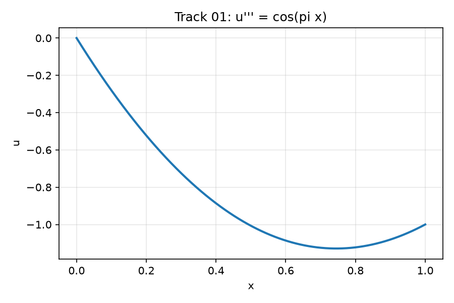 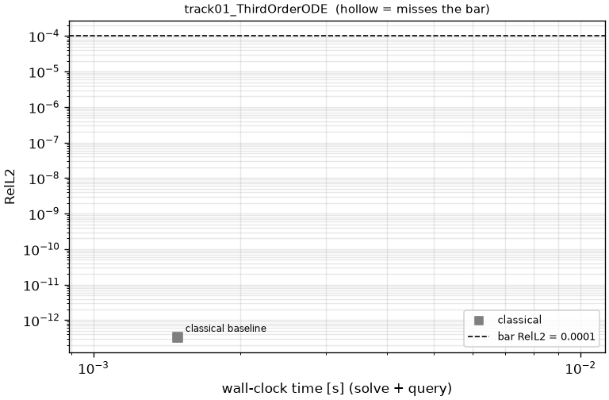</p>

### 02A Wave
`u_tt = u_xx` on (t, x) ∈ [0, 1]², `u = 0` at x = 0, 1, `u(0, x) = x(1 − x)`, `u_t(0, x) = 0`. Output: 201 × 201
(t, x) grid. Reference: d'Alembert (exact).

<p>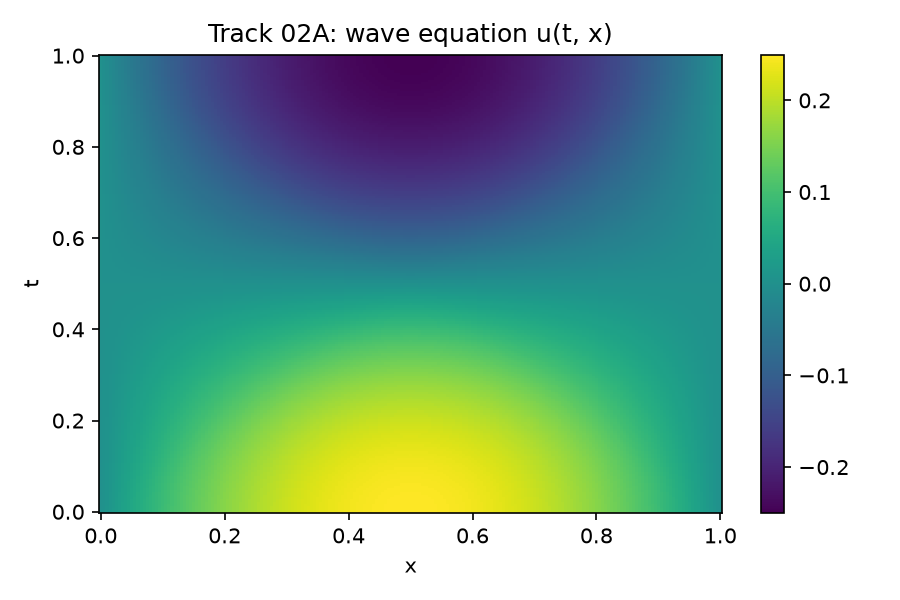 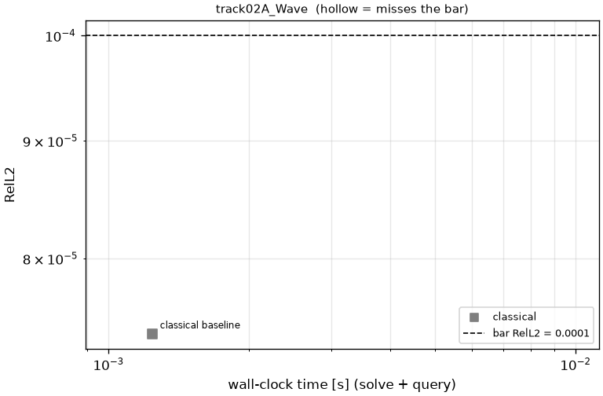</p>

### 02B DampedWave
`u_tt = 9 u_xx − 18 u_t` on [0, 1]², Dirichlet walls, `u(0, x) = x(1 − x)`, `u_t(0, x) = 1 − 2x`. The initial velocity
does not vanish at the walls, so u_t jumps along the characteristics from the corners and sine-series methods
converge only at first order. Output: 201 × 201 (t, x) grid. Reference: exact modal sine series, K = 32768.

<p>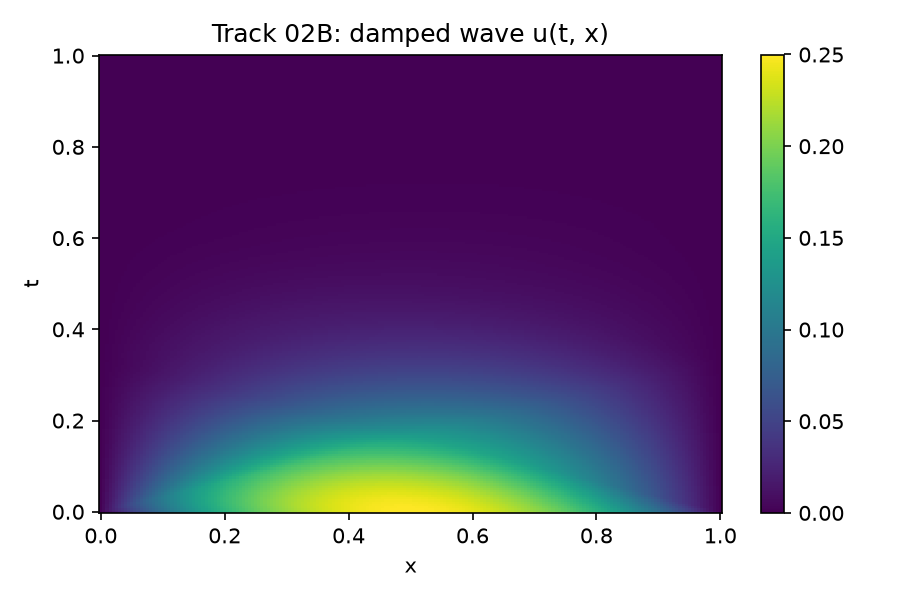 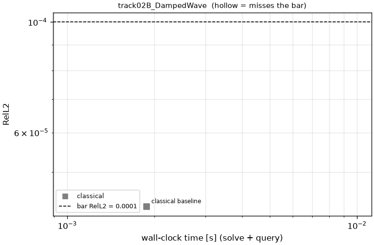</p>

### 03 HighContrastDiffusion
`−∇·(a∇u) = 18` on [0, 1]², `u = 0` on the boundary, `a = 1e3` in a 3 × 3 array of square inclusions and 1
elsewhere. The inclusion corners make u singular (~ρ^(2/3)), so FV converges at order ≈ 4/3. Output: 256² cell
centers. Reference: FV on 3840² and 5376² with MG-PCG, Richardson-extrapolated at the measured order
(self-consistency 1e-7).

<p>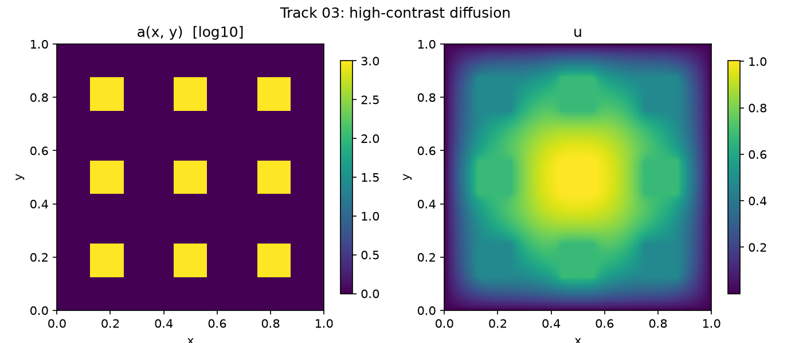 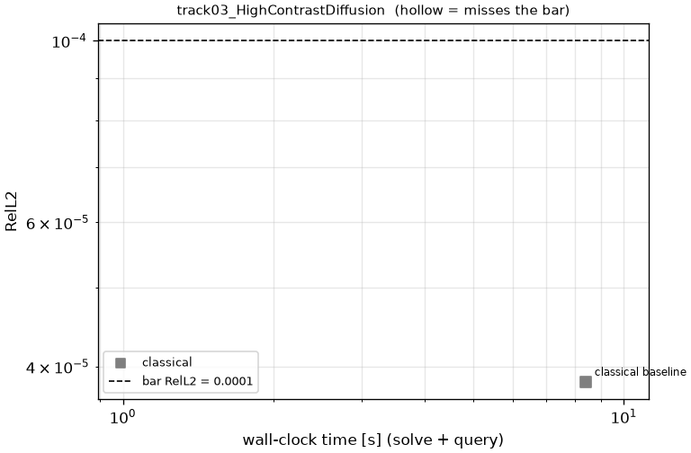</p>

### 04A Helmholtz: on hold
The original setup (lossless Dirichlet box with a slow lens, ω = 40) is resonant. It needs absorption (sponge
layer, PML, or impedance BC) before it is a usable benchmark.

### 04B AdvectionDiffusion
`−ε Δu + u_x + u_y = f` on [0, 1]², ε = 1e-3, `u = 0` on the boundary, with f manufactured so that
`u = g(x) g(y)`, which has boundary layers of width ε at x = 1 and y = 1. Output: 257² Chebyshev–Lobatto grid
(clustered at the walls). Reference: closed form (not usable by solvers, rule 1).

<p>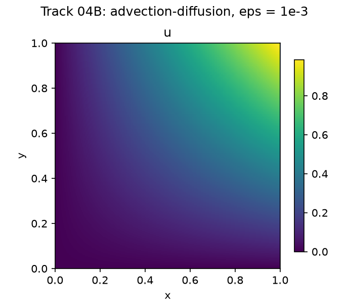 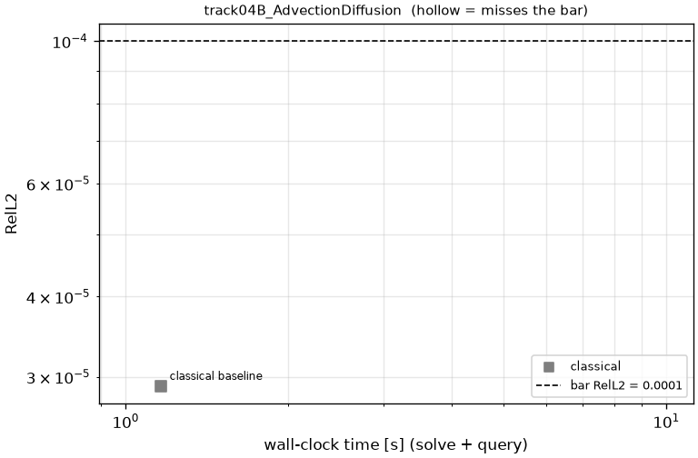</p>

### 05A Burgers1D
`u_t + u u_x = ν u_xx`, ν = 1e-4, periodic x ∈ [0, 2), t ∈ [0, 0.5], with a smooth bump IC (μ = 0.6) that steepens
toward a shock at t ≈ 0.53. Output: 500 t × 1024 x. Reference: Fourier + ETDRK4, N = 8192.

<p>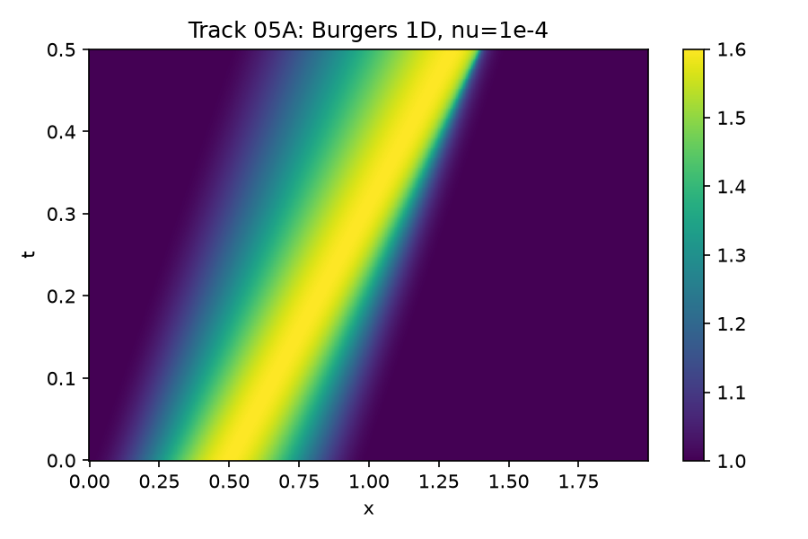 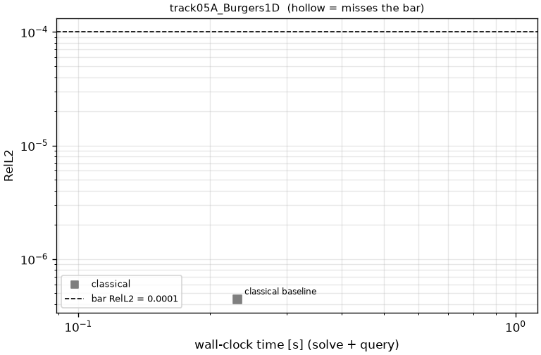</p>

### 05B Burgers2D
Vector Burgers `u_t + (u·∇)u = ν Δu`, ν = 1e-3, periodic [−0.25, 0.75)², t ∈ [0, 0.5], with `u = v = sin(2πx) sin(2πy)`
on [0, 0.5]² and 0 elsewhere. Shocks of width ~ν form. Output: (u, v) at 11 t × 512². Reference: Fourier + ETDRK4,
2048², dt = 2.5e-4.

<p>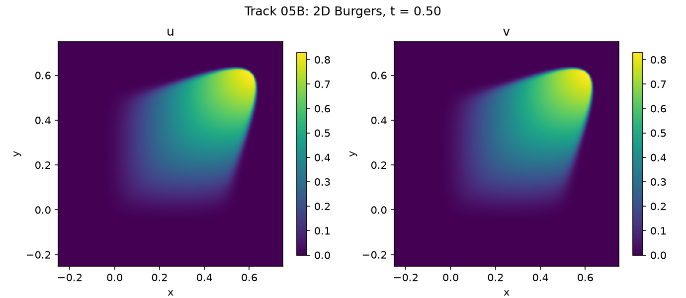 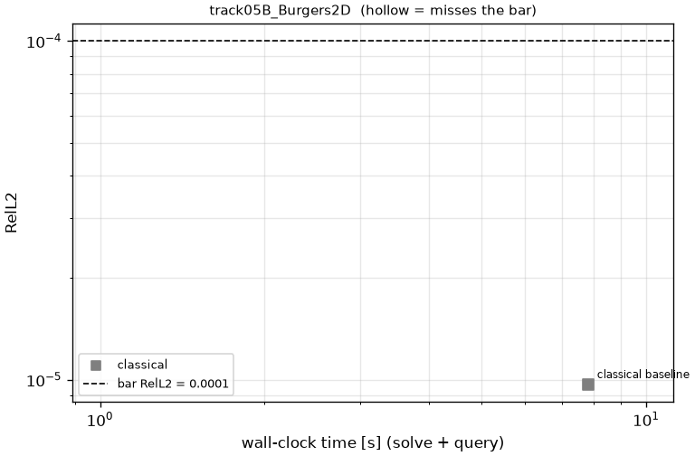</p>

### 05C KuramotoSivashinsky
`u_t + u u_x + u_xx + ν u_xxxx = 0`, ν = 0.01, periodic x ∈ [−π, π), t ∈ [0, 0.1], Gaussian IC (σ = 0.2). Output:
1000 t × 256 x. Reference: Fourier + ETDRK4, N = 1024.

<p> 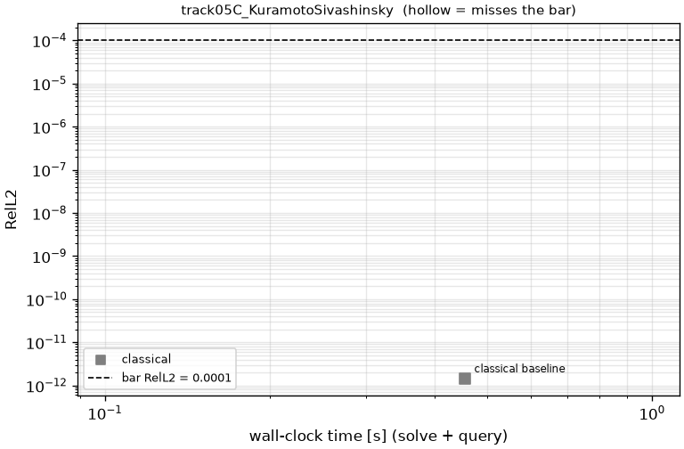</p>

### 06A Kovasznay
Steady incompressible NS at Re = 40 on [−0.5, 2] × [−0.5, 1.5]. The Dirichlet velocity on the whole boundary is
that of the Kovasznay solution; the interior is unknown to the solver. Output: (u, v) on 251 × 201. Reference:
closed form.

<p>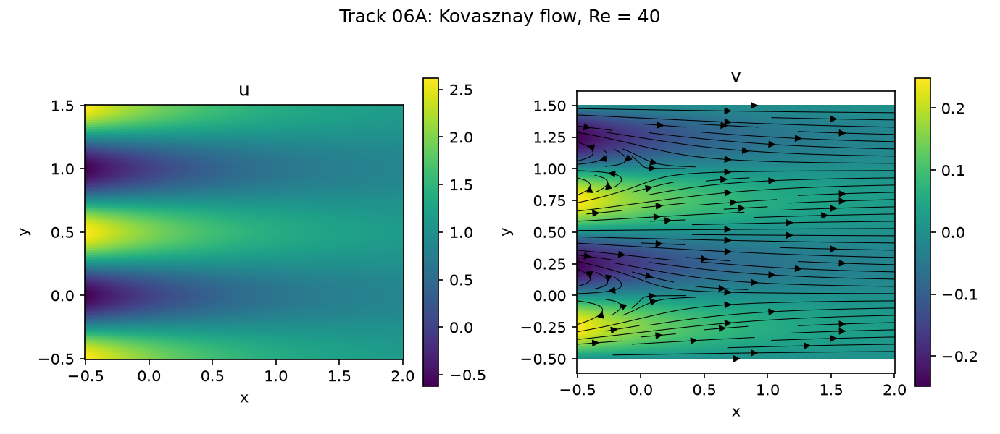 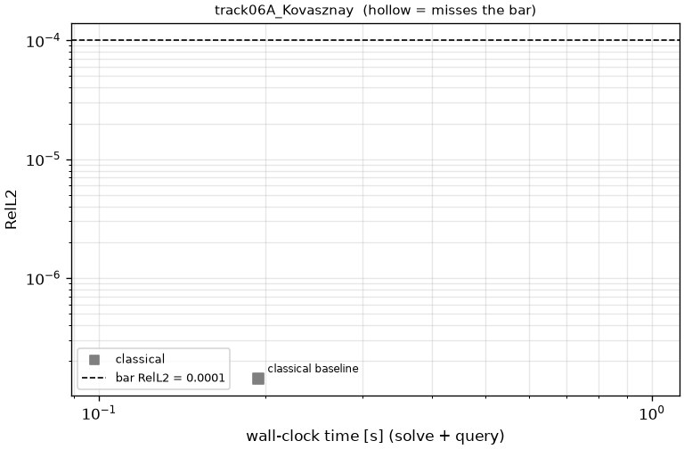</p>

### 06B KovasznayCurved
The same flow in a curved quadrilateral: the Gordon–Hall image of [−1, 1]² under
`x = r(3 + s)/4`, `y = (1 + s)/2 · (1 − r²/2) − (1 − s)/4`, a trapezoid with a parabolic top. Output: (u, v) at the
mapped points of a 201 × 201 (r, s) grid (`problem.fns["map"]`). Reference: closed form.

<p>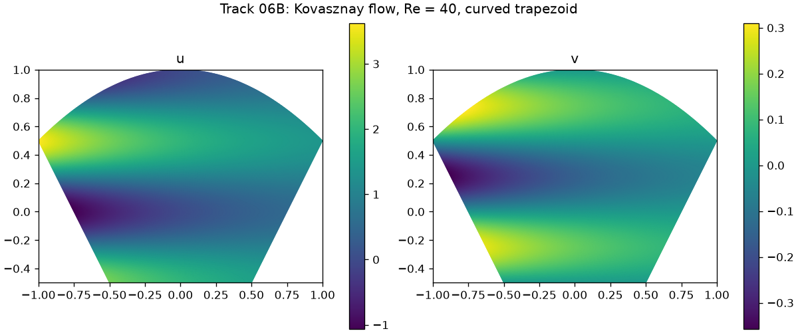 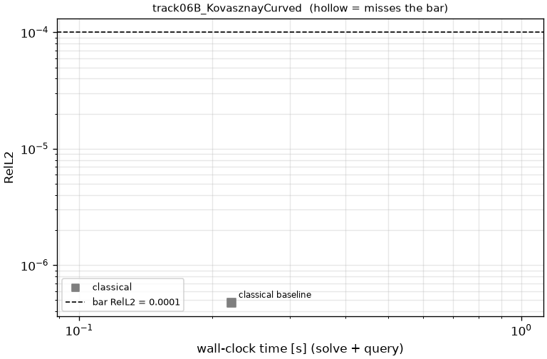</p>

### 07A CavityRe100: TODO
Unsteady incompressible NS, Re = 100, in [−1, 1]². Lid `u = 1` on y = 1 (including the top corners), no-slip
elsewhere, fluid at rest at t = 0, t ∈ [0, 5]. Output: (u, v) at t = 0.5, 1, …, 5 on 129². The velocity is
discontinuous at the top corners. Single-element spectral references therefore converge only ~N⁻¹ in RelL2
over all points and ~N⁻² away from the walls. The planned bar is RelL2 ≤ 1e-3, with L∞ ≤ 1e-3 excluding
points within 0.05 of the walls. **TODO:** the reference (PN–PN-2 at N ≥ 384, BDF3/EXT3) is not
finalized; see PLAN.md.

### 07B CavityRe1000: TODO
Same as 07A at Re = 1000.

### 08 StokesCavity
Steady Stokes flow in the 07A cavity. Output: (u, v) on 129². Reference: PN–PN-2, N = 768, Uzawa CG
(self-consistency vs N = 512: 1.1e-4 RelL2, 3.4e-5 scored L∞).

<p>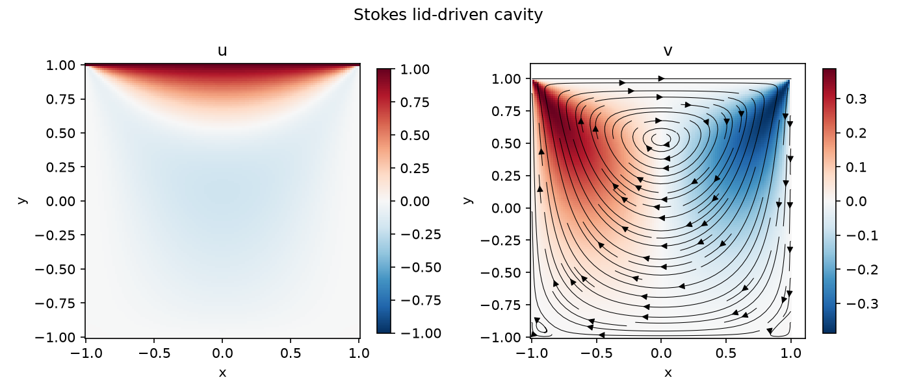 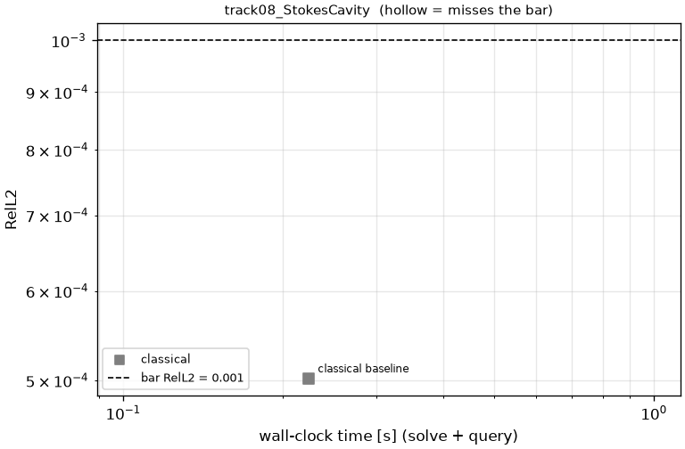</p>

### 09 DecayingEddies (Walsh 1992)
Unsteady NS, ν = 0.05, periodic [0, 2π)², t ∈ [0, 5], from `u = sin 5y + cos 3x cos 4y`, `v = cos 5x + 0.75 sin 3x sin 4y`.
Output: (u, v) at 11 t × 128². Reference: closed form (`|k|² = 25` eigenmodes decay as `exp(−25νt)`).

<p>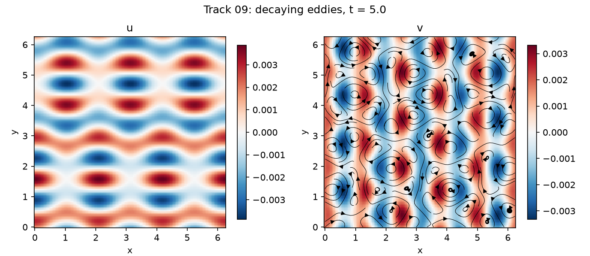 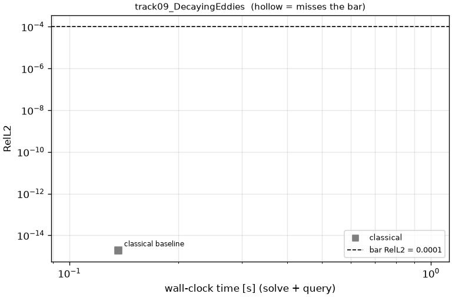</p>

### 10 CylinderFlow: TODO
Flow past a cylinder. Not set up yet; see `tracks/track10_CylinderFlow/TODO.md`.

## Repository layout

```
speedrun/
  problem.py        Problem: the only input a submission receives (incl. its accuracy bar)
  metrics.py        RelL2 / L∞ / pass criteria (default bar)
  run.py            timing + scoring harness + GPU check
  devicecheck.py    per-op device accounting
  make_reference.py references + figures
  records.py        leaderboards, activity plots, per-track READMEs
  tracks.py         track registry, reference I/O
  submissions/      code shared across tracks by a submission: submission_PR<NNNN>/ (e.g. PR0001: vanilla PINN)
  numerics/         shared classical building blocks (PyTorch): Chebyshev, Fourier/ETDRK4, Krylov,
                    FV + multigrid, Legendre PN–PN-2 spectral elements (sem.py)
tracks/
  <track>/problem.py  reference.py  baseline.py (record #0)  records.json  README.md
          figures/  reference/  submissions/submission_PR<NNNN>/
```
