# NeuralPDESpeedrun.py

A speedrun for **data-free** PDE solving. Each track is one PDE problem: solve it as fast as possible on one
H100, from the governing equations alone, to a fixed accuracy against a closed-form or high-resolution
reference.

**Goals.** The classical solvers here are reference points, not opponents to beat on every track. We want to
(1) improve hybrid neural methods, measured honestly on wall-clock time-to-accuracy, and (2) find problems
where hybrid neural methods give outsized leverage, i.e. where classical methods are slow. New tracks that
expose such regimes are as valuable as new records. We do not expect one method to win every track; each
submission competes per track.

## Quickstart

```bash
uv sync
uv run python -m speedrun.make_reference --track all --device cuda   # references + figures
uv run python -m speedrun.run --track 01                            # time + score track 01's baseline
uv run python -m speedrun.records --track all                       # leaderboards, plots, per-track READMEs
```

Tracks can be named in full (`track05B_Burgers2D`) or by key (`05B`).

## Scoring

Score = wall-clock time of `solve` + `query`, provided the output meets the track's accuracy bar against the
reference on all fields and evaluation points:

- **RelL2** `‖u − u_ref‖₂ / ‖u_ref‖₂ ≤ 1e-4`
- **L∞** `max |u − u_ref| ≤ 1e-3`

Tracks may override the bar or exclude a wall margin from L∞. Pressure is never scored.

## Rules

1. **Data-free.** Use only what `Problem` provides. No reference or solver outputs, precomputed solutions,
   downloaded data, or pretraining of any kind. A closed form used to manufacture forcing (04B) is off limits.
2. **Anything else goes.** Any model, ansatz, loss, optimizer, discretization, precision, or mix of neural and
   classical parts. Python, JAX, and Julia are all fine (the entry point is Python; call into JAX or Julia from
   it), and so are hand-written GPU kernels (Triton, CUDA, ...).
3. **No oracle.** The method decides when to stop; it is scored once, on what it returns. The reference is
   loaded only after the clock stops.
4. **Timing.** `warmup` is untimed and may build and compile, but not train on the problem or compute any part
   of its solution. `solve` and `query` are each timed with GPU syncs; `query` must finish in ≤ 5 s.
5. **One run, seed 0, on the GPU.** The harness reruns the submission once (untimed) and counts torch ops by
   device. Work it cannot see (JAX, Julia, custom kernels) is checked by the maintainers.
6. **Official times** are maintainer re-timings on one H100 80GB. Record #0 on each track is an honest but
   deliberately unoptimized classical baseline.

## Submission API

Per track, `tracks/<track>/submissions/submission_PR<NNNN>/solve.py` defines:

```python
def warmup(problem):              # optional, untimed: build + compile
    return MySolver(problem).compile()

def solve(problem, solver):       # timed: train / iterate / solve
    solver.train()
    return solver

def query(problem, solver):       # timed separately, <= 5 s: evaluate at the output points
    return solver.predict(problem.axes)    # torch.Tensor of shape problem.out_shape
```

- All state lives in the solver object; no module-level globals. Without `warmup`, `solver` is `None`.
- Learning need not happen on the evaluation points: `query` projects onto them, a tensor of shape
  `problem.out_shape = (n_fields, len(axis_0), ...)` on the tensor grid of `problem.axes` (`indexing="ij"`).
- If `solve` returns that tensor directly, `query` is skipped (this is how the classical baselines work).

`Problem` holds the statement and `params`, IC/BC/forcing/coefficient callables (`fns`; on tracks whose initial
state is only known as data, `fns["ic"]` holds it as samples on the output grid), the `domain` bounds,
per-axis `periodic` flags, the evaluation `axes` and output layout, `device`/`dtype` (CUDA, float64; compute in
any precision), and the track's bar.

**Shared code.** Code a submission reuses across tracks goes in `speedrun/submissions/submission_PR<NNNN>/`, and
the per-track `solve.py` files import it (e.g. `speedrun/submissions/submission_PR0001/pinn.py`). The classical
toolbox `speedrun/numerics/` is available to everyone.

### Submitting

1. **Open a draft PR.** Its number names your directories, zero-padded (PR #42 → `submission_PR0042`).
2. Add your files, run the harness on your GPU, and push as often as you like:
   ```
   speedrun/submissions/submission_PR<NNNN>/        shared code (optional)
   tracks/<track>/submissions/submission_PR<NNNN>/
     solve.py  result.json  previous.json (current record, same GPU)  README.md (method, what changed)
   ```
   ```bash
   d=tracks/track03_HighContrastDiffusion/submissions/submission_PR0042
   uv run python -m speedrun.run --track 03 --submission $d --out $d/result.json
   uv run python -m speedrun.records --track 03 --add $d/result.json --name "my method" --kind hybrid --pr 42
   ```
3. **Mark the PR ready for review** when you want the maintainers to re-time it.

Results that miss the bar stay as points on the track's accuracy-vs-time plot, but they are not records.

## Tracks

The table lists the best submission on each track. Until some submission meets the track's accuracy bar, the
best is the most accurate one (lowest RelL2); once the bar is met, it is the fastest one that meets it. Classical
baselines (record #0, where a track has one) are reference points listed in each `tracks/<track>/README.md`, not
in this table. Times are pending H100 re-timing. Tracks 05C, 07 and 11–16 are the benchmarks of the PirateNet /
SOAP-for-PINNs study (Wang et al.); their references are the published solutions (`speedrun/external.py`).

Each track below shows its reference solution (animation where time-dependent) and, once it has submissions,
its tracker: RelL2 vs wall-clock time, one point per submission, bar dashed.

<!-- tracks-table:begin -->
| track | best submission | time [s] | RelL2 | L∞ | bar met |
|---|---|---|---|---|---|
| 01 VanDerPol | — | | | | |
| 02 DampedWave | — | | | | |
| 03 HighContrastDiffusion | — | | | | |
| 04A Helmholtz | *on hold* | | | | |
| 04B AdvectionDiffusion | — | | | | |
| 05A Burgers1D | — | | | | |
| 05B Burgers2D | — | | | | |
| 05C KuramotoSivashinsky | — | | | | |
| 06 Kovasznay | — | | | | |
| 07 LidDrivenCavity | — | | | | |
| 08 DecayingEddies | — | | | | |
| 09 CylinderFlow | *TODO* | | | | |
| 10 BeltramiFlow | *TODO* | | | | |
| 11 AllenCahn | — | | | | |
| 12 KdV | — | | | | |
| 13 GreyScott | — | | | | |
| 14 GinzburgLandau | — | | | | |
| 15 RayleighTaylor | — | | | | |
| 16 KolmogorovFlow | — | | | | |
<!-- tracks-table:end -->

### 01 VanDerPol
Stiff ODE: `y'' − μ(1 − y²) y' + y = 0`, μ = 1000, `y(0) = 2`, `y'(0) = 0`, t ∈ [0, 3000] (almost two relaxation
periods: slow drifts on a time scale ~μ, jumps lasting ~1/μ). Output: y at 3001 uniform times. Reference: Radau
IIA, rtol 1e-12.


### 02 DampedWave
`u_tt = u_xx − 0.5 u_t` on (t, x) ∈ [0, 4] × [0, 1], `u = 0` at x = 0, 1, a narrow Gaussian pulse
`u(0, x) = exp(−(x − 0.3)²/(2·0.02²))`, `u_t(0, x) = 0`. The two halves cross the domain four times, reflecting
off the walls. Output: 801 t × 1001 x. Reference: exact sine series (closed-form coefficients).


### 03 HighContrastDiffusion
`−∇·(a∇u) = 18` on [0, 1]², `u = 0` on the boundary, `a = 1e3` in a 3 × 3 array of square inclusions, 1
elsewhere. The inclusion corners make u singular (~ρ^(2/3)). Output: 256² cell centers. Reference: FV on 3840²
and 5376², Richardson-extrapolated at the measured order 1.34.


### 04A Helmholtz: on hold
The original setup (lossless Dirichlet box with a slow lens, ω = 40) is resonant. It needs absorption (sponge,
PML, or impedance BC) first.

### 04B AdvectionDiffusion
`−ε Δu + u_x + u_y = f` on [0, 1]², ε = 1e-3, `u = 0` on the boundary, with boundary layers of width ε at x = 1
and y = 1. Output: 257² Chebyshev–Lobatto grid. Reference: closed form (f was manufactured from it; rule 1).


### 05A Burgers1D
`u_t + u u_x = ν u_xx`, ν = 1e-4, periodic x ∈ [0, 2), t ∈ [0, 0.5], smooth bump IC steepening toward a shock at
t ≈ 0.53. Output: 500 t × 1024 x. Reference: Fourier + ETDRK4, N = 8192.


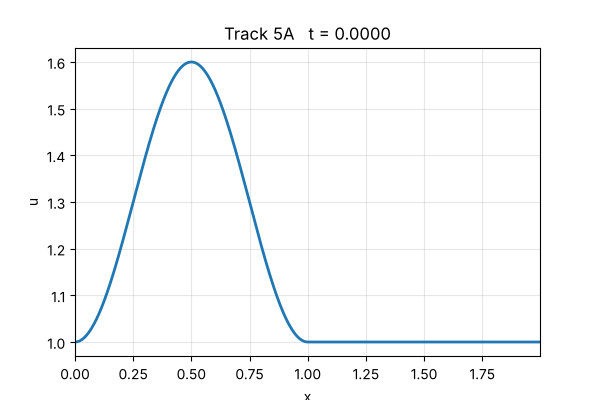


### 05B Burgers2D
`u_t + (u·∇)u = ν Δu`, ν = 1e-3, periodic [−0.25, 0.75)², t ∈ [0, 0.5], `u = v = sin(2πx) sin(2πy)` on [0, 0.5]²,
0 elsewhere; shocks of width ~ν form. Output: (u, v) at 11 t × 512². Reference: Fourier + ETDRK4, 2048².

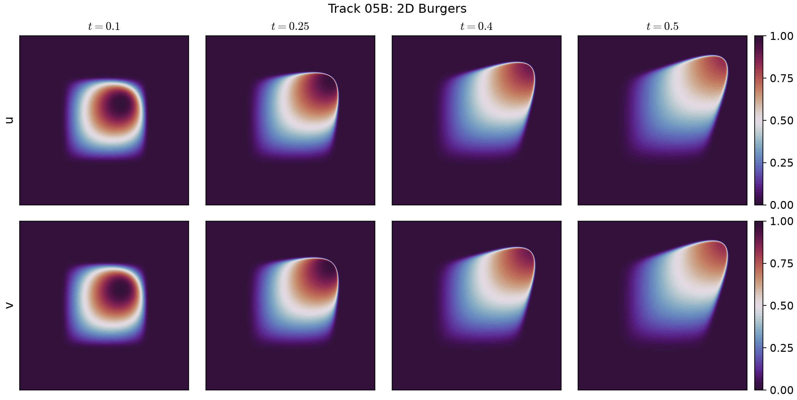

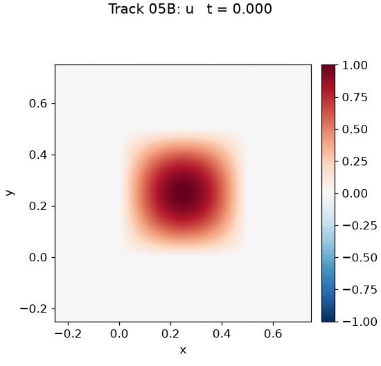


### 05C KuramotoSivashinsky
`u_t + (100/16) u u_x + (100/16²) u_xx + (100/16⁴) u_xxxx = 0`, x ∈ [0, 2π] periodic, t ∈ [0, 1], chaotic regime;
the initial state is given as samples. Output: 250 t × 512 x. **Bar: RelL2 ≤ 5e-2, L∞ ≤ 0.5.** Reference: published data.


### 06 Kovasznay
Steady incompressible NS, Re = 40, on [−0.5, 2] × [−0.5, 1.5], with the Kovasznay velocity as Dirichlet data on the
whole boundary. Output: (u, v) on 251 × 201. Reference: closed form.


### 07 LidDrivenCavity
Steady NS, Re = 5000, in [0, 1]², lid `u = 1 − cosh(50(x − 0.5))/cosh(25)` on y = 1, no-slip elsewhere. Output: (u, v)
on 256². **Bar: RelL2 ≤ 5e-2, L∞ ≤ 0.1 at points ≥ 0.05 from the walls.** Reference: published data.

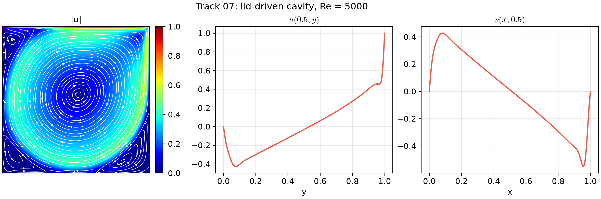

### 08 DecayingEddies
Unsteady NS, ν = 0.05, periodic [0, 2π)², t ∈ [0, 5], from `u = sin 5y + cos 3x cos 4y`,
`v = cos 5x + 0.75 sin 3x sin 4y` (Walsh 1992). Output: (u, v) at 11 t × 128². Reference: closed form.

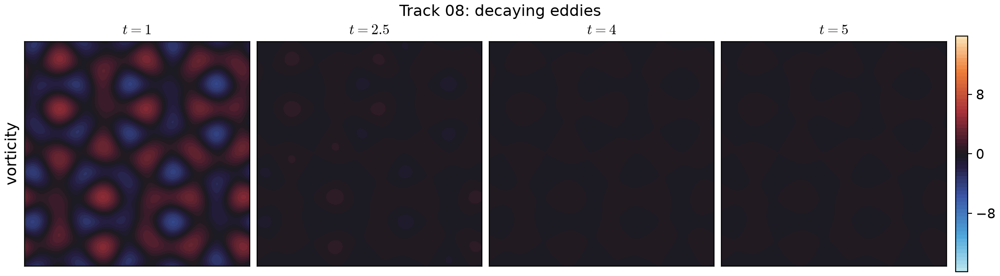

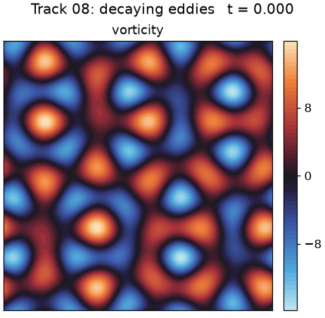


### 09 CylinderFlow: TODO
Flow past a cylinder; see `tracks/track09_CylinderFlow/TODO.md`.

### 10 BeltramiFlow: TODO
3D unsteady Navier–Stokes, Re = 1, on [−1, 1]³ × [0, 1] with the Ethier–Steinman exact solution (as in
arXiv:2402.10680, §4.2); see `tracks/track10_BeltramiFlow/TODO.md`.

### 11 AllenCahn
`u_t − 1e-4 u_xx + 5u³ − 5u = 0`, x ∈ [−1, 1] periodic, t ∈ [0, 1], `u(0, x) = x² cos(πx)`. Output: 200 t × 512 x.
Reference: published data.

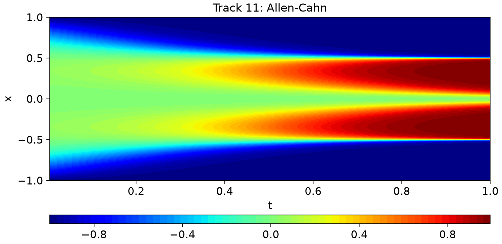

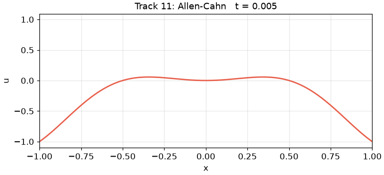

### 12 KdV
`u_t + u u_x + 0.022² u_xxx = 0`, x ∈ [−1, 1] periodic, t ∈ [0, 1], `u(0, x) = cos(πx)`; the cosine breaks into
solitons. Output: 200 t × 512 x. **Bar: RelL2 ≤ 1e-3, L∞ ≤ 1e-2.** Reference: published data.

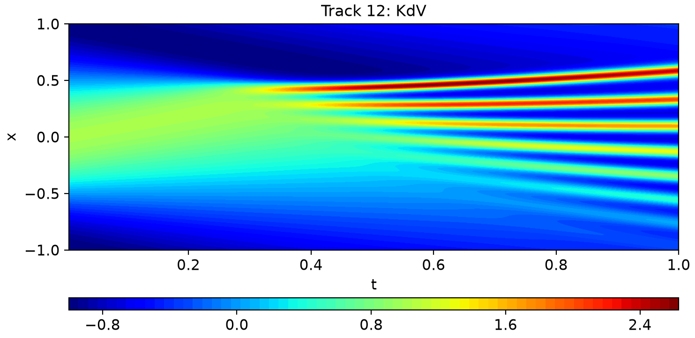

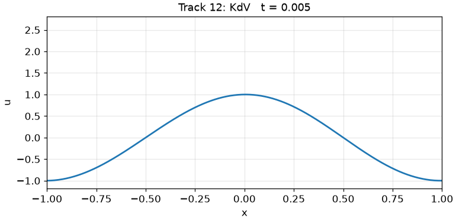

### 13 GreyScott
`u_t = 0.2 Δu + 40(1 − u) − 1000 u v²`, `v_t = 0.1 Δv − 100 v + 1000 u v²` on [−1, 1]² periodic, t ∈ [0, 2], initial
state given as samples. Output: (u, v) at 100 t × 200². **Bar: RelL2 ≤ 1e-3, L∞ ≤ 1e-2.** Reference: published data.

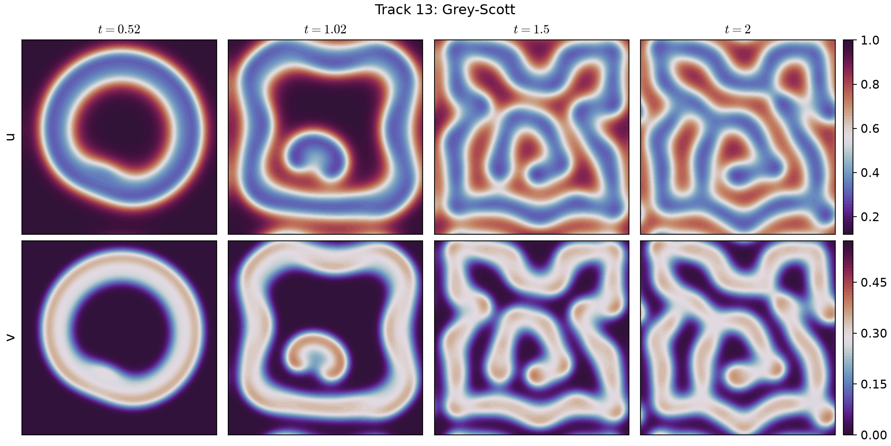

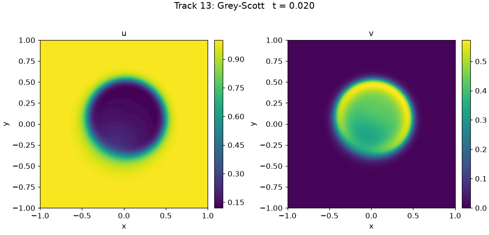

### 14 GinzburgLandau
Complex Ginzburg–Landau for A = u + iv, ε = 0.004, k = 10, on [−1, 1]² periodic, t ∈ [0, 1], initial state given as
samples. Output: (u, v) at 100 t × 200². **Bar: RelL2 ≤ 1e-2, L∞ ≤ 5e-2.** Reference: published data.

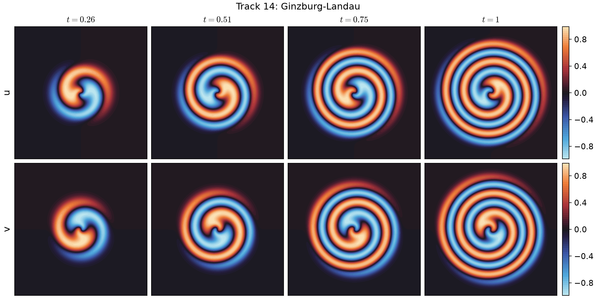

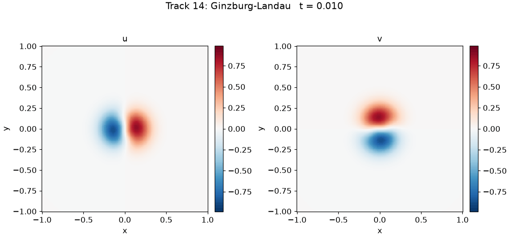

### 15 RayleighTaylor
Boussinesq Rayleigh–Taylor instability, Ra = 1e6, Pr = 0.71, on [0, 1] × [0, 2], t ∈ [0, 8.5], initial state given as
samples. Output: (u, v, T) at 34 t on a 100 × 200 grid. **Bar: RelL2 ≤ 2e-2, L∞ ≤ 0.1.** Reference: published data.

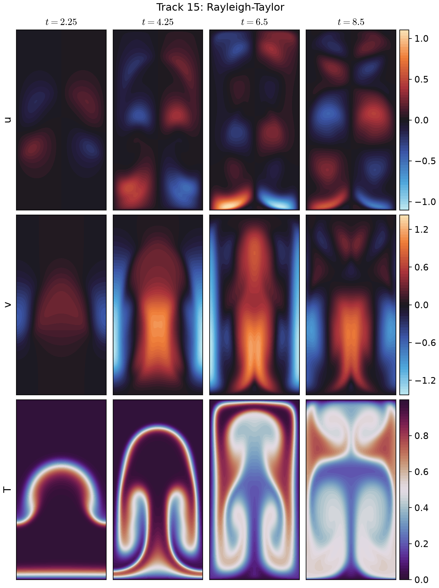

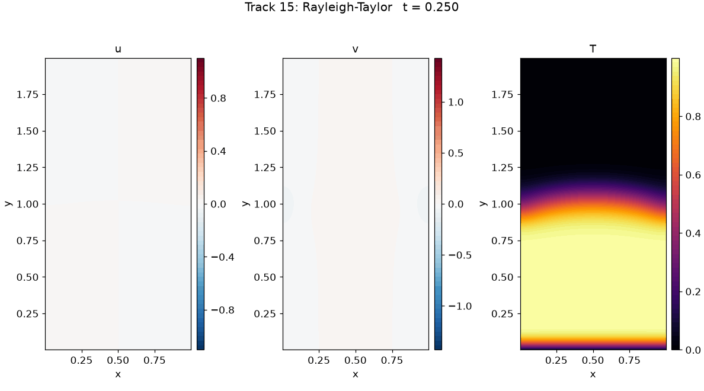

### 16 KolmogorovFlow
Forced 2D NS, Re = 1e4, forcing `2 sin(4πy)` in x, on [0, 1)² periodic, t ∈ [0, 1.96], initial state given as
samples; turbulent. Output: (u, v) at 49 t × 256². **Bar: RelL2 ≤ 5e-2, L∞ ≤ 0.5.** Reference: published data.

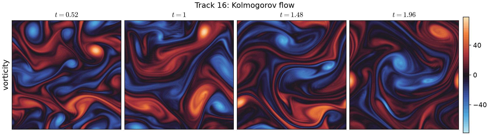

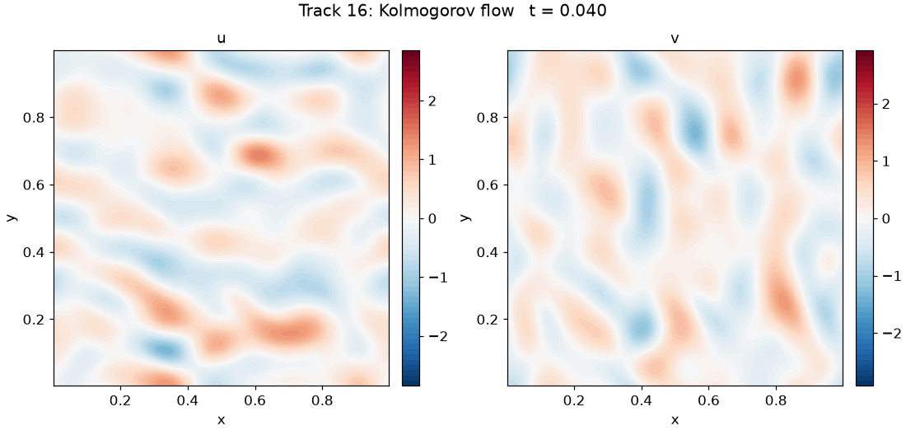

## Layout

```
speedrun/
  problem.py  metrics.py  run.py (harness)  devicecheck.py  make_reference.py  records.py  tracks.py
  numerics/       classical toolbox: Chebyshev, Fourier/ETDRK4, Krylov, FV + multigrid, PN–PN-2 spectral elements
  submissions/    code shared across tracks by a submission: submission_PR<NNNN>/
tracks/<track>/
  problem.py  reference.py  baseline.py (record #0)  records.json  README.md
  figures/  reference/  submissions/submission_PR<NNNN>/
```
