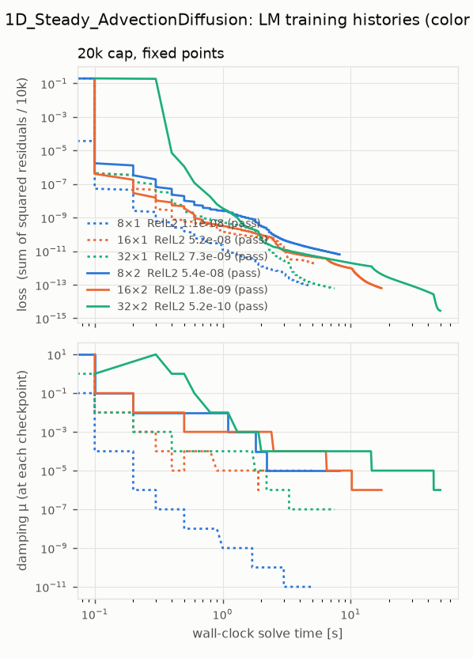
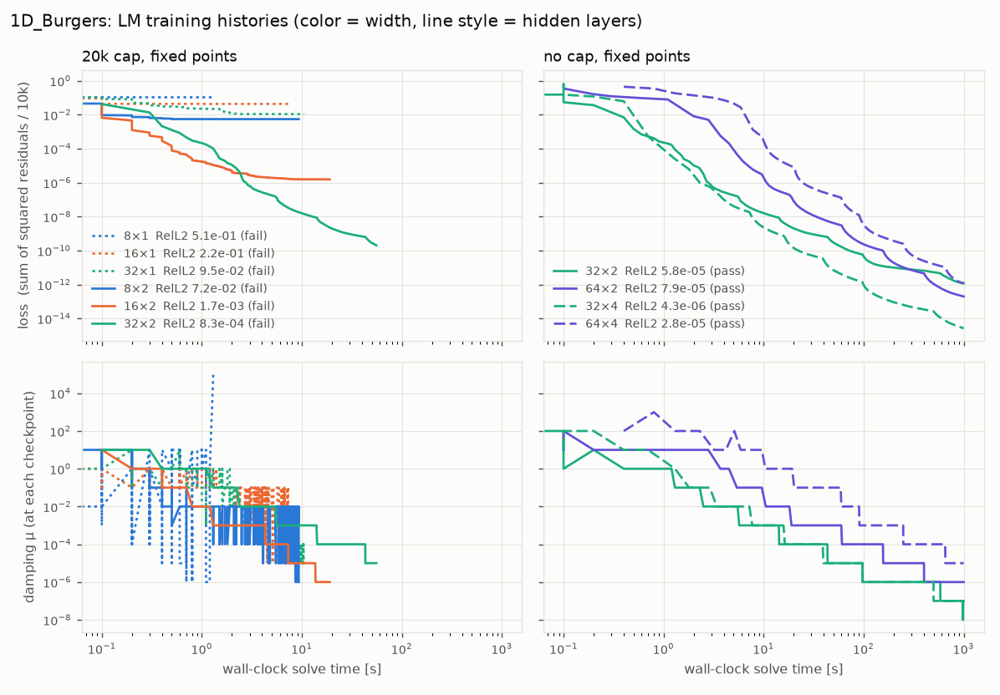
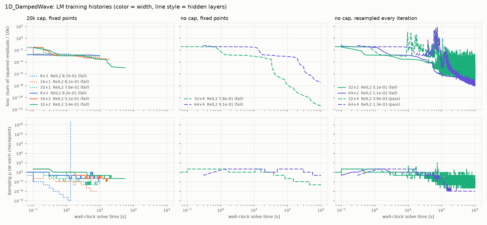
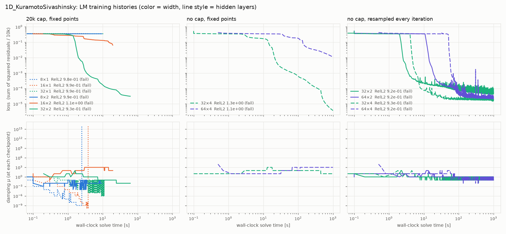
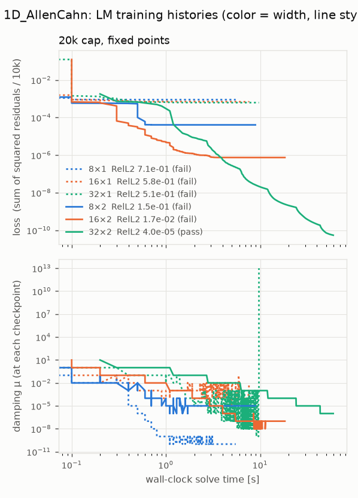
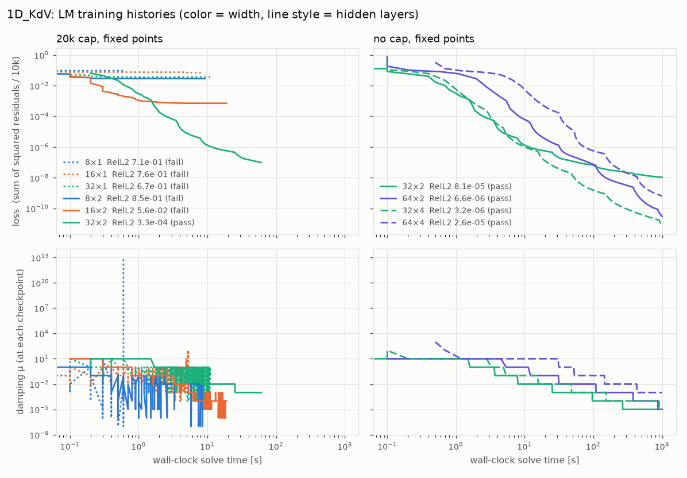

# submission_PR0004: shallow PINNs trained by Levenberg-Marquardt (PR #4)

After Shahab, Mukhlash & Susanto, *Do physics-informed neural networks (PINNs) need to be deep? Shallow PINNs
using the Levenberg-Marquardt algorithm* ([arXiv:2602.08515](https://arxiv.org/abs/2602.08515)), in JAX, float64,
on the 1D tracks. Code: [`pinn.py`](pinn.py); per-track residuals and settings in
`tracks/<track>/submissions/submission_PR0004/solve.py`.

## Method

- **Network**: tanh MLP, one output, `layers` hidden layers of `width` neurons; Glorot-normal weights, zero
  biases, seed 0; all parameters in one flat vector. One network on the whole space-time domain (no time windows).
  Inputs: a periodic axis enters as (sin, cos)(2π(x − lo)/L), so periodicity is exact (the only condition built
  into the network); any other axis is scaled to [−1, 1].
- **Residual**: the PDE residual at 10k uniform random interior points, plus one group of rows per initial or
  Dirichlet condition (500 random points on the face; KS: its 512 given initial samples), each group scaled by
  √(10k / its size), so the loss is mean(PDE²) + Σ mean(condition²). Interior points are drawn once (the paper),
  or, with `resample=True` (DampedWave, KS), redrawn every LM iteration; the current loss, J and all trial steps of
  one iteration then use the same points.
- **Derivatives**: all by JAX AD — input derivatives by Taylor mode (`jax.experimental.jet`), the residual
  Jacobian J by reverse mode per point (`vmap(grad)`); nothing hand-derived.
- **Optimizer**: textbook Levenberg-Marquardt as in the paper (MATLAB `fsolve`): solve (JᵀJ + μI) d = JᵀF by
  Cholesky with **no preconditioning or scaling**; if ‖F(w − d)‖² < ‖F(w)‖² accept and μ ← μ/10, else reject,
  μ ← 10μ and retry. μ₀ = 0.01. Stops at the iteration cap (if any), when ‖d‖ < 1e-12 (1e-12 + ‖w‖), when no μ
  ≤ 1e16 lowers the loss, or at the harness budget.
- **Execution**: float64 throughout, everything compiled ahead of time in `setup`. The LM loop runs on the device
  in chunks of at most 50 iterations and about 1 s; the host checkpoints between chunks.

## Recorded configurations

| track | net | iterations | sampling | time [s] | RelL2 | RelL∞ | bar | previous record |
|---|---|---|---|---|---|---|---|---|
| 1D_Steady_AdvectionDiffusion | 8×1 | 20k cap | fixed | **4.86** | 1.1e-8 | 1.4e-8 | ✅ record | 37.5 s (PR0002) |
| 1D_AllenCahn | 32×2 | 20k cap | fixed | **59.6** | 4.0e-5 | 2.6e-3 | ✅ record | 108.7 s (PR0002) |
| 1D_KdV | 32×2 | 20k cap | fixed | 60.7 | 3.3e-4 | 5.3e-4 | ✅ | 15.2 s (PR0002) |
| 1D_Burgers | 32×4 | no cap | fixed | 1000 | 4.4e-6 | 6.1e-5 | ✅ | 200.1 s (PR0002) |
| 1D_DampedWave | 64×4 | no cap | resampled | **1000** | 1.3e-3 | 1.3e-3 | ✅ first pass | none passed |
| 1D_KuramotoSivashinsky | 32×2 | no cap | resampled | 1000 | 0.92 | 1.12 | ❌ | 542.6 s (PR0002) |

There is no stopping rule besides the cap and LM's own tests, so uncapped runs always use the full budget even
when they reach the bar much earlier. A residual-based stopping tolerance is the obvious next step.

## Experiments

1. **Hard vs soft conditions** (1D_Steady_AdvectionDiffusion, 32×2, 4k iterations): u = x(1 − x)·ũ (the paper)
   9.87 s, RelL2 1.9e-9; u = ũ with the walls as residual rows 10.03 s, RelL2 2.2e-8. Kept soft.
2. **Sweep, 20k cap**: widths 8, 16, 32 × 1, 2 hidden layers on all six tracks, fixed points.
3. **No cap** (1000 s budget only): 32×2, 64×2, 32×4, 64×4 on Burgers, KdV, DampedWave, KS, fixed points.
   DampedWave and KS reach tiny losses with large errors (the networks fit the 10k fixed points, not the solution),
   so those two were stopped and rerun with **points redrawn every iteration** (the 64×2 fixed-point runs were
   killed mid-run and are not reported).

Notes on the data below: loss is the logged sum of squared residuals / 10k at each checkpoint (for resampled runs,
on that iteration's points). μ is sampled at the checkpoints (every ≤ 50 iterations), so its min/max are of those
samples; at steady state μ alternates between neighbouring powers of 10 (one rejected trial, then an accepted one).
Sweep 2 ran before the time-based chunking and the resampling option were added; the fixed-point path reproduces
it bit for bit. Times are solve times on one H100 80GB.

### 1D_Steady_AdvectionDiffusion

| setup | net | params | iterations | time [s] | ms / iter | loss: final (min) | μ: final [min, max] | stopped by | RelL2 | RelL∞ | bar |
|---|---|---|---|---|---|---|---|---|---|---|---|
| 20k cap, fixed points | 8×1 | 25 | 20000 | 4.9 | 0.24 | 8.8e-14 (8.8e-14) | 1e-11 [1e-11, 1e+00] | 20k-iteration cap | 1.1e-06% | 1.4e-06% | ✅ |
| 20k cap, fixed points | 16×1 | 49 | 20000 | 5.2 | 0.26 | 1.8e-12 (1.8e-12) | 1e-05 [1e-06, 1e+00] | 20k-iteration cap | 5.21e-06% | 6.38e-06% | ✅ |
| 20k cap, fixed points | 32×1 | 97 | 20000 | 7.5 | 0.37 | 6.1e-14 (6.1e-14) | 1e-07 [1e-07, 1e+00] | 20k-iteration cap | 7.29e-07% | 7.84e-07% | ✅ |
| 20k cap, fixed points | 8×2 | 97 | 20000 | 8.2 | 0.41 | 6.3e-12 (6.3e-12) | 1e-05 [1e-05, 1e+01] | 20k-iteration cap | 5.4e-06% | 5.98e-06% | ✅ |
| 20k cap, fixed points | 16×2 | 321 | 20000 | 17.4 | 0.87 | 6.2e-14 (6.2e-14) | 1e-06 [1e-06, 1e+01] | 20k-iteration cap | 1.78e-07% | 2.36e-07% | ✅ |
| 20k cap, fixed points | 32×2 | 1153 | 20000 | 50.1 | 2.51 | 2.8e-15 (2.8e-15) | 1e-06 [1e-06, 1e+01] | 20k-iteration cap | 5.2e-08% | 5.62e-08% | ✅ |

### 1D_Burgers

| setup | net | params | iterations | time [s] | ms / iter | loss: final (min) | μ: final [min, max] | stopped by | RelL2 | RelL∞ | bar |
|---|---|---|---|---|---|---|---|---|---|---|---|
| 20k cap, fixed points | 8×1 | 33 | 4385 | 1.3 | 0.29 | 1.2e-01 (1.2e-01) | 1e+05 [1e-06, 1e+05] | step tolerance | 50.5% | 97.9% | ❌ |
| 20k cap, fixed points | 16×1 | 65 | 20000 | 7.3 | 0.36 | 4.3e-02 (4.3e-02) | 1e-01 [1e-05, 1e+01] | 20k-iteration cap | 21.8% | 117% | ❌ |
| 20k cap, fixed points | 32×1 | 129 | 20000 | 10.5 | 0.52 | 1.1e-02 (1.1e-02) | 1e-05 [1e-05, 1e+01] | 20k-iteration cap | 9.54% | 39.6% | ❌ |
| 20k cap, fixed points | 8×2 | 105 | 20000 | 9.3 | 0.46 | 5.5e-03 (5.5e-03) | 1e-06 [1e-06, 1e+01] | 20k-iteration cap | 7.19% | 59.6% | ❌ |
| 20k cap, fixed points | 16×2 | 337 | 20000 | 19.0 | 0.95 | 1.5e-06 (1.5e-06) | 1e-06 [1e-06, 1e+01] | 20k-iteration cap | 0.166% | 2.24% | ❌ |
| 20k cap, fixed points | 32×2 | 1185 | 20000 | 55.5 | 2.77 | 2.0e-10 (2.0e-10) | 1e-05 [1e-05, 1e+01] | 20k-iteration cap | 0.0835% | 1.07% | ❌ |
| no cap, fixed points | 32×2 | 1185 | 358063 | 1000.0 | 2.79 | 1.2e-12 (1.2e-12) | 1e-07 [1e-08, 1e+02] | budget | 0.00581% | 0.187% | ✅ |
| no cap, fixed points | 64×2 | 4417 | 58813 | 1000.6 | 17.01 | 2.0e-13 (2.0e-13) | 1e-06 [1e-06, 1e+02] | budget | 0.00793% | 0.254% | ✅ |
| no cap, fixed points | 32×4 | 3297 | 92813 | 1000.4 | 10.78 | 2.7e-15 (2.7e-15) | 1e-07 [1e-07, 1e+02] | budget | 0.000435% | 0.00608% | ✅ |
| no cap, fixed points | 64×4 | 12737 | 6814 | 1000.3 | 146.81 | 1.1e-12 (1.1e-12) | 1e-05 [1e-05, 1e+03] | budget | 0.00282% | 0.0406% | ✅ |

### 1D_DampedWave

| setup | net | params | iterations | time [s] | ms / iter | loss: final (min) | μ: final [min, max] | stopped by | RelL2 | RelL∞ | bar |
|---|---|---|---|---|---|---|---|---|---|---|---|
| 20k cap, fixed points | 8×1 | 33 | 4694 | 1.3 | 0.28 | 2.3e-03 (2.3e-03) | 1e+16 [1e-09, 1e+16] | mu > mu_max | 86.6% | 77.9% | ❌ |
| 20k cap, fixed points | 16×1 | 65 | 20000 | 7.8 | 0.39 | 1.2e-03 (1.2e-03) | 1e-06 [1e-06, 1e+00] | 20k-iteration cap | 81.4% | 67.5% | ❌ |
| 20k cap, fixed points | 32×1 | 129 | 20000 | 10.1 | 0.50 | 8.0e-04 (8.0e-04) | 1e-04 [1e-04, 1e+00] | 20k-iteration cap | 70% | 54.3% | ❌ |
| 20k cap, fixed points | 8×2 | 105 | 20000 | 9.8 | 0.49 | 1.2e-03 (1.2e-03) | 1e-02 [1e-03, 1e+01] | 20k-iteration cap | 82.5% | 69.9% | ❌ |
| 20k cap, fixed points | 16×2 | 337 | 20000 | 18.4 | 0.92 | 3.1e-04 (3.1e-04) | 1e-02 [1e-03, 1e+01] | 20k-iteration cap | 50.6% | 46.7% | ❌ |
| 20k cap, fixed points | 32×2 | 1185 | 20000 | 54.8 | 2.74 | 1.1e-05 (1.1e-05) | 1e-02 [1e-02, 1e+01] | 20k-iteration cap | 34.2% | 34.7% | ❌ |
| no cap, fixed points | 32×4 | 3297 | 90963 | 1000.4 | 11.00 | 3.9e-12 (3.9e-12) | 1e-04 [1e-04, 1e+01] | budget | 77.9% | 77.6% | ❌ |
| no cap, fixed points | 64×4 | 12737 | 6766 | 1000.4 | 147.86 | 3.3e-08 (3.3e-08) | 1e-01 [1e-01, 1e+01] | budget | 91.3% | 77.9% | ❌ |
| no cap, resampled every iteration | 32×2 | 1185 | 356963 | 1000.1 | 2.80 | 1.1e-05 (1.1e-07) | 1e-04 [1e-05, 1e+01] | budget | 50.6% | 112% | ❌ |
| no cap, resampled every iteration | 64×2 | 4417 | 56913 | 1000.8 | 17.59 | 8.4e-08 (8.3e-08) | 1e-02 [1e-03, 1e+01] | budget | 1.07% | 0.95% | ❌ |
| no cap, resampled every iteration | 32×4 | 3297 | 91063 | 1000.3 | 10.99 | 4.6e-07 (5.0e-08) | 1e-03 [1e-03, 1e+03] | budget | 0.393% | 0.334% | ✅ |
| no cap, resampled every iteration | 64×4 | 12737 | 6800 | 1000.5 | 147.14 | 9.1e-09 (6.6e-09) | 1e-06 [1e-06, 1e+01] | budget | 0.135% | 0.133% | ✅ |

### 1D_KuramotoSivashinsky

| setup | net | params | iterations | time [s] | ms / iter | loss: final (min) | μ: final [min, max] | stopped by | RelL2 | RelL∞ | bar |
|---|---|---|---|---|---|---|---|---|---|---|---|
| 20k cap, fixed points | 8×1 | 41 | 9177 | 2.6 | 0.28 | 3.7e-01 (3.7e-01) | 1e+16 [1e-09, 1e+16] | mu > mu_max | 98% | 110% | ❌ |
| 20k cap, fixed points | 16×1 | 81 | 9245 | 3.8 | 0.41 | 3.6e-01 (3.6e-01) | 1e+16 [1e-10, 1e+16] | mu > mu_max | 98.8% | 111% | ❌ |
| 20k cap, fixed points | 32×1 | 161 | 20000 | 11.0 | 0.55 | 3.6e-01 (3.6e-01) | 1e-01 [1e-06, 1e+00] | 20k-iteration cap | 99.3% | 112% | ❌ |
| 20k cap, fixed points | 8×2 | 113 | 20000 | 9.4 | 0.47 | 3.5e-01 (3.5e-01) | 1e-02 [1e-04, 1e+01] | 20k-iteration cap | 99.4% | 113% | ❌ |
| 20k cap, fixed points | 16×2 | 353 | 20000 | 19.4 | 0.97 | 6.5e-02 (6.5e-02) | 1e+02 [1e-01, 1e+03] | 20k-iteration cap | 110% | 120% | ❌ |
| 20k cap, fixed points | 32×2 | 1217 | 20000 | 61.7 | 3.08 | 3.1e-05 (3.1e-05) | 1e-02 [1e-02, 1e+02] | 20k-iteration cap | 92.7% | 113% | ❌ |
| no cap, fixed points | 32×4 | 3329 | 94413 | 1000.2 | 10.59 | 3.7e-06 (3.7e-06) | 1e+01 [1e+01, 1e+03] | budget | 129% | 908% | ❌ |
| no cap, fixed points | 64×4 | 12801 | 7053 | 1000.2 | 141.81 | 1.1e-02 (1.1e-02) | 1e+03 [1e+01, 1e+04] | budget | 107% | 397% | ❌ |
| no cap, resampled every iteration | 32×2 | 1217 | 312763 | 1000.0 | 3.20 | 5.1e-05 (4.1e-05) | 1e-01 [1e-01, 1e+02] | budget | 91.7% | 112% | ❌ |
| no cap, resampled every iteration | 64×2 | 4481 | 57113 | 1000.4 | 17.52 | 1.9e-05 (1.7e-05) | 1e-01 [1e-02, 1e+02] | budget | 92.1% | 111% | ❌ |
| no cap, resampled every iteration | 32×4 | 3329 | 92963 | 1000.4 | 10.76 | 1.6e-05 (1.5e-05) | 1e-01 [1e-02, 1e+02] | budget | 93.2% | 111% | ❌ |
| no cap, resampled every iteration | 64×4 | 12801 | 7135 | 1000.3 | 140.20 | 2.9e-05 (2.1e-05) | 1e-01 [1e-02, 1e+04] | budget | 92.4% | 112% | ❌ |

### 1D_AllenCahn

| setup | net | params | iterations | time [s] | ms / iter | loss: final (min) | μ: final [min, max] | stopped by | RelL2 | RelL∞ | bar |
|---|---|---|---|---|---|---|---|---|---|---|---|
| 20k cap, fixed points | 8×1 | 41 | 20000 | 5.5 | 0.28 | 8.9e-04 (8.9e-04) | 1e-10 [1e-10, 1e+01] | 20k-iteration cap | 70.6% | 191% | ❌ |
| 20k cap, fixed points | 16×1 | 81 | 20000 | 7.6 | 0.38 | 6.9e-04 (6.9e-04) | 1e-02 [1e-05, 1e+01] | 20k-iteration cap | 58.4% | 176% | ❌ |
| 20k cap, fixed points | 32×1 | 161 | 17869 | 9.7 | 0.54 | 6.2e-04 (6.2e-04) | 1e+13 [1e-09, 1e+13] | step tolerance | 50.7% | 175% | ❌ |
| 20k cap, fixed points | 8×2 | 113 | 20000 | 8.9 | 0.45 | 4.1e-05 (4.1e-05) | 1e-05 [1e-06, 1e+01] | 20k-iteration cap | 14.8% | 88.2% | ❌ |
| 20k cap, fixed points | 16×2 | 353 | 20000 | 18.3 | 0.92 | 7.4e-07 (7.4e-07) | 1e-07 [1e-08, 1e+01] | 20k-iteration cap | 1.66% | 19.5% | ❌ |
| 20k cap, fixed points | 32×2 | 1217 | 20000 | 59.6 | 2.98 | 5.4e-11 (5.4e-11) | 1e-06 [1e-06, 1e+01] | 20k-iteration cap | 0.00403% | 0.259% | ✅ |

### 1D_KdV

| setup | net | params | iterations | time [s] | ms / iter | loss: final (min) | μ: final [min, max] | stopped by | RelL2 | RelL∞ | bar |
|---|---|---|---|---|---|---|---|---|---|---|---|
| 20k cap, fixed points | 8×1 | 41 | 2043 | 0.6 | 0.29 | 9.4e-02 (9.4e-02) | 1e+13 [1e-07, 1e+13] | step tolerance | 70.9% | 109% | ❌ |
| 20k cap, fixed points | 16×1 | 81 | 20000 | 8.0 | 0.40 | 7.0e-02 (7.0e-02) | 1e+00 [1e-04, 1e+02] | 20k-iteration cap | 75.7% | 110% | ❌ |
| 20k cap, fixed points | 32×1 | 161 | 20000 | 11.0 | 0.55 | 3.6e-02 (3.6e-02) | 1e-01 [1e-05, 1e+01] | 20k-iteration cap | 66.7% | 104% | ❌ |
| 20k cap, fixed points | 8×2 | 113 | 20000 | 9.2 | 0.46 | 2.9e-02 (2.9e-02) | 1e-02 [1e-07, 1e+01] | 20k-iteration cap | 84.7% | 115% | ❌ |
| 20k cap, fixed points | 16×2 | 353 | 20000 | 19.0 | 0.95 | 7.1e-04 (7.1e-04) | 1e-04 [1e-06, 1e+01] | 20k-iteration cap | 5.58% | 5.75% | ❌ |
| 20k cap, fixed points | 32×2 | 1217 | 20000 | 60.7 | 3.04 | 9.6e-08 (9.6e-08) | 1e-03 [1e-03, 1e+01] | 20k-iteration cap | 0.0335% | 0.0526% | ✅ |
| no cap, fixed points | 32×2 | 1217 | 329963 | 1000.1 | 3.03 | 1.1e-08 (1.1e-08) | 1e-05 [1e-05, 1e+01] | budget | 0.00813% | 0.0124% | ✅ |
| no cap, fixed points | 64×2 | 4481 | 58613 | 1000.8 | 17.07 | 3.0e-11 (3.0e-11) | 1e-05 [1e-05, 1e+01] | budget | 0.000665% | 0.00109% | ✅ |
| no cap, fixed points | 32×4 | 3329 | 95563 | 1000.0 | 10.46 | 7.4e-12 (7.4e-12) | 1e-05 [1e-05, 1e+02] | budget | 0.000315% | 0.000412% | ✅ |
| no cap, fixed points | 64×4 | 12801 | 7147 | 1000.7 | 140.01 | 6.4e-10 (6.4e-10) | 1e-03 [1e-03, 1e+03] | budget | 0.00261% | 0.00373% | ✅ |

