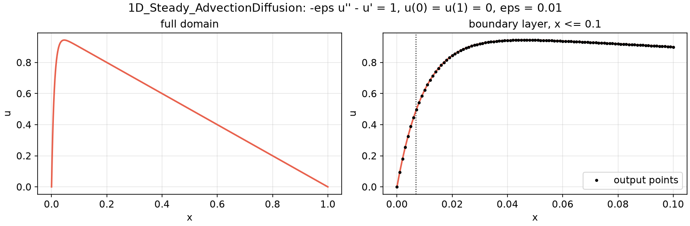
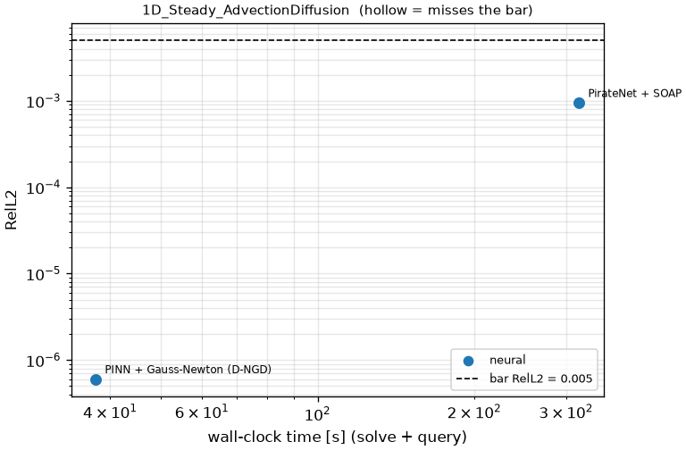
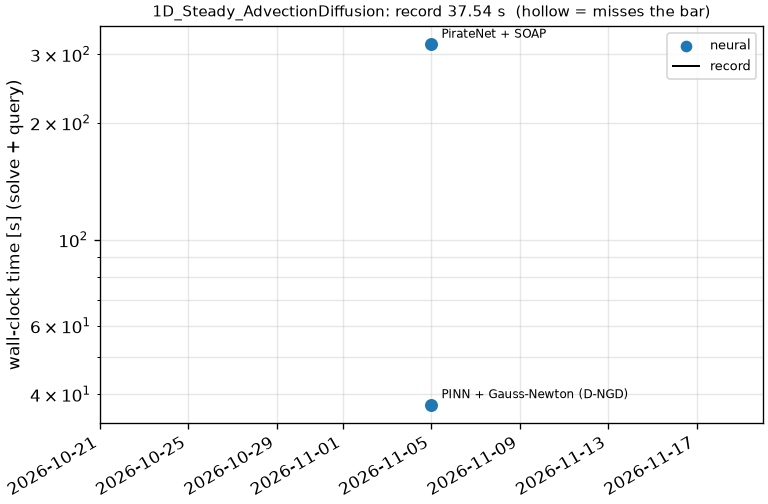

# 1D_Steady_AdvectionDiffusion: 1D steady advection-diffusion, boundary layer, eps = 0.01

```text
Steady advection-diffusion on [0, 1] (flow toward x = 0):

    -eps u'' - u' = 1,      eps = 0.01
    u(0) = u(1) = 0

Away from x = 0 the solution follows the outer solution 1 - x; it drops to 0 across a boundary layer of width
~eps at the outflow wall x = 0 (u = 1/2 at x ~ eps ln 2, slope u'(0) ~ 1/eps).

Output: u at x_i = i / 1000, i = 0..1000; shape (1, 1001).
```

**Accuracy bar:** RelL2 ≤ 0.005, RelL∞ ≤ 0.01. **Budget:** 1000 s of wall-clock solve time.



## Reference

exact solution

- `check_chebyshev_N128_linf`: 1.366e-14

## Records

Current record: **37.54 s** (PINN + Gauss-Newton (D-NGD), maintainers, 2026-11-05, NVIDIA H100 80GB HBM3 (JAX)).

| date | author | name | kind | time [s] | RelL2 | RelL∞ | passes | hardware |
|---|---|---|---|---|---|---|---|---|
| 2026-11-05 | maintainers | PirateNet + SOAP | neural | 317.9 | 9.45e-04 | 1.36e-03 | yes | NVIDIA H100 80GB HBM3 (JAX) |
| 2026-11-05 | maintainers | PINN + Gauss-Newton (D-NGD) | neural | 37.54 | 6.00e-07 | 8.33e-07 | yes | NVIDIA H100 80GB HBM3 (JAX) |




