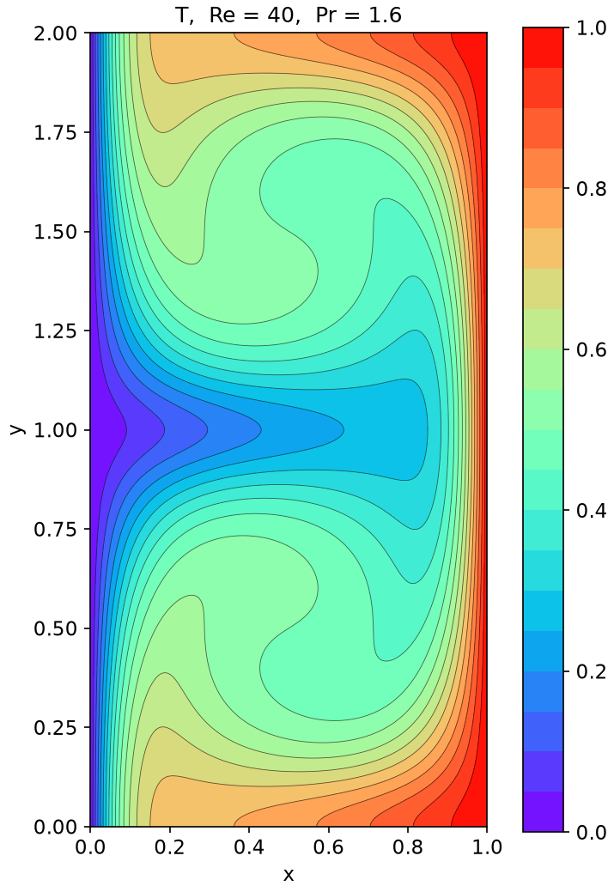
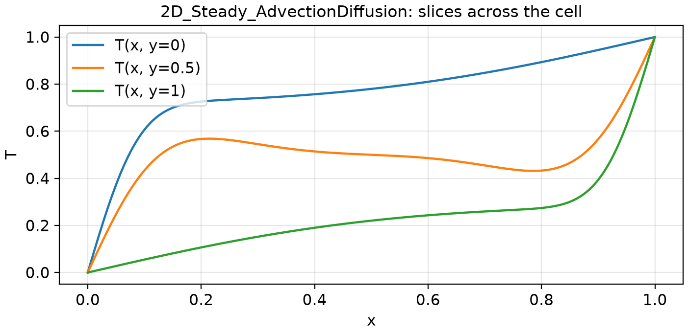

# 2D_Steady_AdvectionDiffusion: 2D steady advection-diffusion, cellular flow, Pe = 64

```text
Steady advection-diffusion of temperature T(x, y) on [0, 1] x [0, 2] by a prescribed cellular flow:

    (1 / (Re Pr)) (T_xx + T_yy) - u T_x - v T_y = 0,      Re = 40, Pr = 1.6  (Pe = Re Pr = 64)
    u = -sin(pi x) cos(pi y),   v = cos(pi x) sin(pi y)      (two counter-rotating cells, divergence-free)
    T(0, y) = 0 (cold wall),   T(1, y) = 1 (hot wall),   T_y(x, 0) = T_y(x, 2) = 0 (insulated walls)

The flow sweeps hot fluid from the hot wall along the insulated walls toward the cold wall, and cold fluid
back along the cell boundary y = 1, bending the isotherms into an S around each cell.

Output: T on the uniform grid x_i = i / 256, i = 0..256, y_j = j / 256, j = 0..512;
shape (1, 257, 513).
```

**Accuracy bar:** RelL2 ≤ 0.005, RelL∞ ≤ 0.01. **Budget:** 1000 s of wall-clock solve time.




## Reference

Chebyshev collocation on one cell, N = 64, mirrored about y = 1

- `check_N48_linf`: 6.255e-12
- `check_N56_linf`: 6.450e-12
- `check_full_domain_N64x128_linf`: 2.149e-10

## Records

No records yet.
