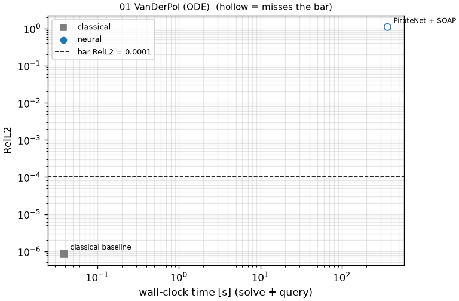
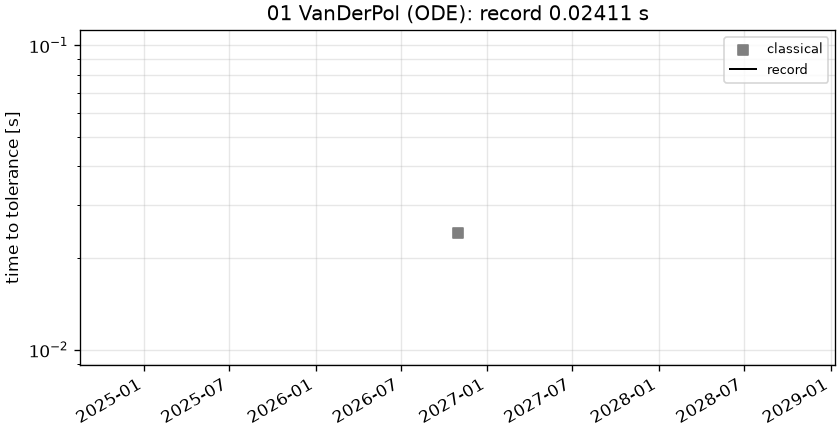

# 01 VanDerPol (ODE): Van der Pol oscillator, mu = 1000 (stiff)

```text
Van der Pol oscillator, t in [0, 3000], mu = 1000 (stiff relaxation oscillations):

    y'' - mu (1 - y^2) y' + y = 0
    y(0) = 2,   y'(0) = 0

The solution alternates between slow drifts (time scale ~ mu) and jumps of size ~3 lasting ~1/mu; the
period is ~ (3 - 2 ln 2) mu ~ 1614, so [0, 3000] covers almost two periods.

Output: y at the 3001 times t = linspace(0, 3000, 3001); shape (1, 3001).
```

**Accuracy bar:** RelL2 ≤ 0.005, RelL∞ ≤ 0.01. **Budget:** 1000 s of wall-clock solve time.


## Reference

Radau IIA (scipy), rtol 1e-12, atol 1e-14, analytic Jacobian

- `check_rtol1e-10_linf`: 3.508e-11
- `check_rtol1e-10_rel_l2`: 7.453e-12

## Records

Current record: **0.02411 s** (record #0: classical baseline, maintainers, 2026-10-30, CPU (Intel(R) Xeon(R) Platinum 8481C CPU @ 2.70GHz)).

| date | author | name | kind | time [s] | RelL2 | RelL∞ | passes | hardware |
|---|---|---|---|---|---|---|---|---|
| 2026-10-30 | maintainers | record #0: classical baseline | classical | 0.02411 | 8.65e-07 | 2.68e-05 | yes | CPU (Intel(R) Xeon(R) Platinum 8481C CPU @ 2.70GHz) |




