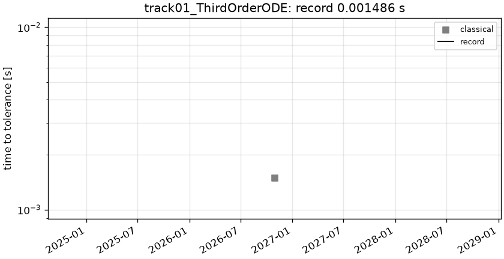

# track01_ThirdOrderODE: 3rd-order ODE  u''' = cos(pi x)

```text
Third-order boundary value problem on x in [0, 1]:

    u'''(x) = cos(pi x)
    u(0) = 0,   u(1) = cos(pi) = -1,   u'(1) = 1

(The NeuralPDE.jl page writes u'(0) = 1 in the text but imposes Dx(u(1)) = 1 in code and in its
analytic solution; we follow the code: u'(1) = 1.)

Output: u at the 1001 uniformly spaced points x = linspace(0, 1, 1001).
```

**Accuracy bar:** RelL2 ≤ 0.0001, L∞ ≤ 0.001.


## Reference

closed form (NeuralPDE.jl docs)

- `check_chebyshev_N32_linf`: 2.976e-11

## Records

Current record: **0.001486 s** (record #0: classical baseline, maintainers, 2026-10-30, NVIDIA GeForce RTX 2080 Ti).

| date | author | name | kind | time [s] | RelL2 | L∞ | hardware |
|---|---|---|---|---|---|---|---|
| 2026-10-30 | maintainers | record #0: classical baseline | classical | 0.001486 | 3.35e-13 | 6.22e-13 | NVIDIA GeForce RTX 2080 Ti |


