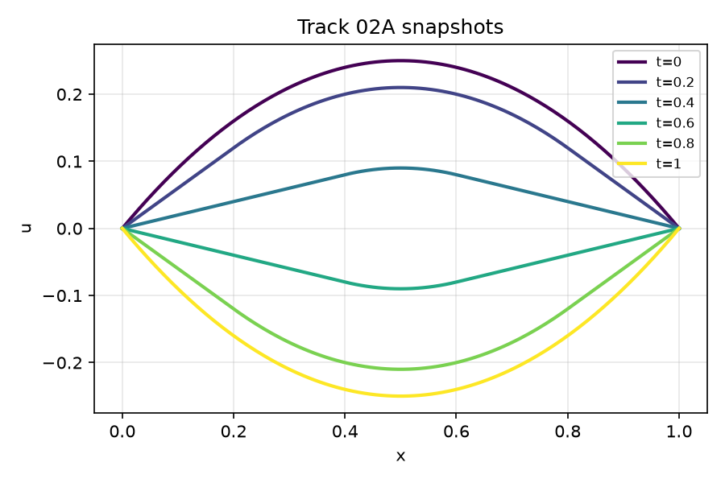
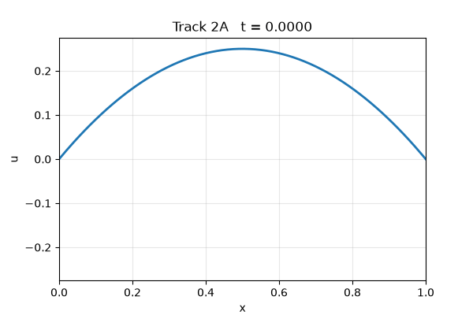
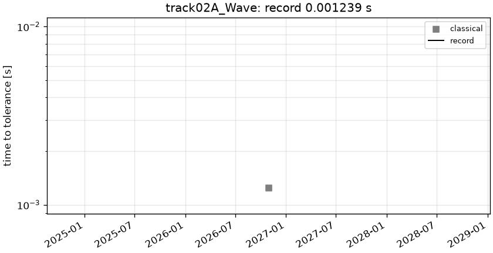

# track02A_Wave: 1D wave equation (Dirichlet)

```text
1D wave equation, c = 1, on (t, x) in [0, 1] x [0, 1]:

    u_tt = c^2 u_xx
    u(t, 0) = u(t, 1) = 0
    u(0, x) = x (1 - x),     u_t(0, x) = 0

Output: u on the tensor grid t = linspace(0, 1, 201) x x = linspace(0, 1, 201), shape (1, 201, 201).
```

**Accuracy bar:** RelL2 ≤ 0.0001, L∞ ≤ 0.001.





## Reference

closed form (d'Alembert)

- `check_vs_sine_series_K4001_linf`: 1.279e-10

## Records

Current record: **0.001239 s** (record #0: classical baseline, maintainers, 2026-10-30, NVIDIA GeForce RTX 2080 Ti).

| date | author | name | kind | time [s] | RelL2 | L∞ | passes | hardware |
|---|---|---|---|---|---|---|---|---|
| 2026-10-30 | maintainers | record #0: classical baseline | classical | 0.001239 | 7.42e-05 | 7.40e-05 | yes | NVIDIA GeForce RTX 2080 Ti |



