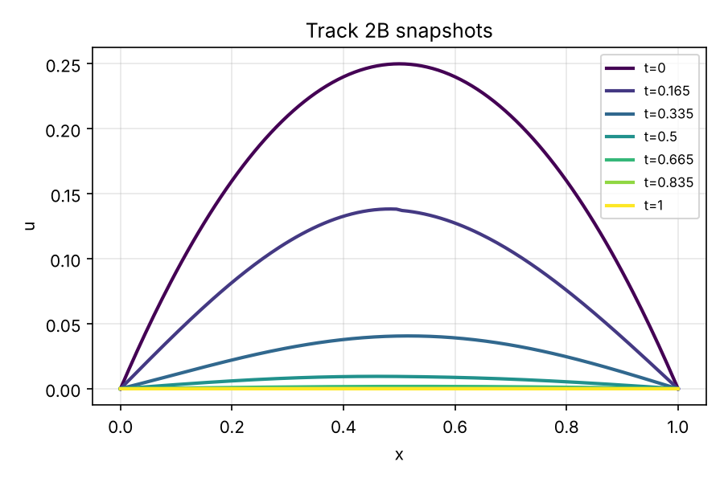
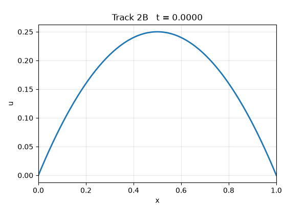
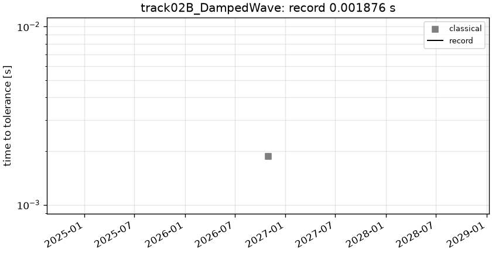

# track02B_DampedWave: 1D damped wave equation

```text
1D damped wave equation on (t, x) in [0, 1] x [0, 1], with v = 3, b = 2 (as implemented in the
NeuralPDE.jl example code):

    u_xx = (1 / v^2) u_tt + b u_t          i.e.   u_tt = v^2 u_xx - b v^2 u_t
    u(t, 0) = u(t, 1) = 0
    u(0, x) = x (1 - x),     u_t(0, x) = 1 - 2x

Note: u_t(0, x) = 1 - 2x does not vanish at the boundary (incompatible with the Dirichlet data), so
u_t is discontinuous along the characteristics x = +-v t leaving the corners. This is part of the problem.

Output: u on the tensor grid t = linspace(0, 1, 201) x x = linspace(0, 1, 201), shape (1, 201, 201).
```

**Accuracy bar:** RelL2 ≤ 0.0001, L∞ ≤ 0.001.





## Reference

exact modal sine series, K=32768

- `check_K8192_vs_K32768_linf`: 2.952e-06

## Records

Current record: **0.001876 s** (record #0: classical baseline, maintainers, 2026-10-30, NVIDIA GeForce RTX 2080 Ti).

| date | author | name | kind | time [s] | RelL2 | L∞ | hardware |
|---|---|---|---|---|---|---|---|
| 2026-10-30 | maintainers | record #0: classical baseline | classical | 0.001876 | 4.26e-05 | 1.17e-04 | NVIDIA GeForce RTX 2080 Ti |


