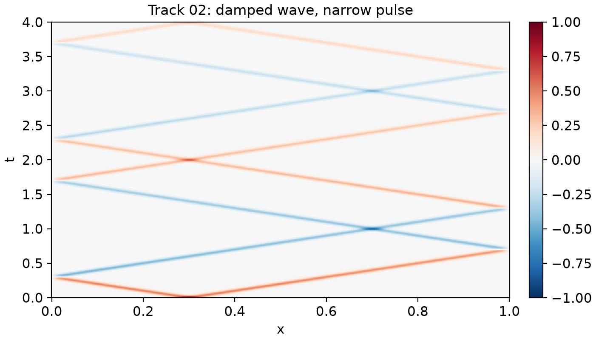
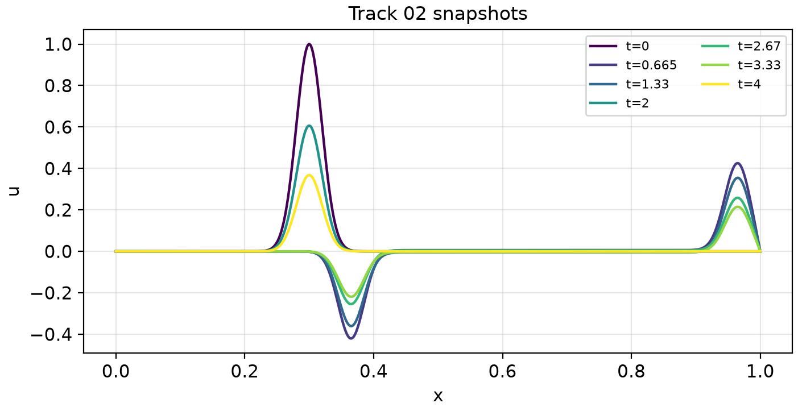
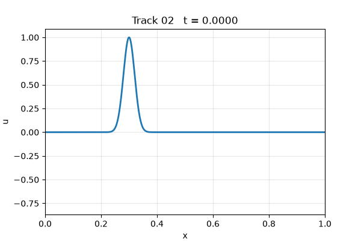
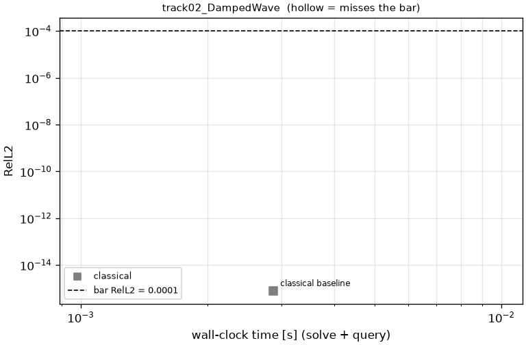
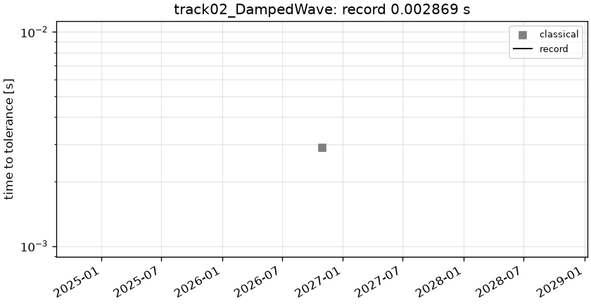

# track02_DampedWave: 1D damped wave, narrow pulse

```text
1D damped wave equation on (t, x) in [0, 4] x [0, 1]:

    u_tt = c^2 u_xx - gamma u_t,        c = 1,  gamma = 0.5
    u(t, 0) = u(t, 1) = 0
    u(0, x) = exp(-(x - 0.3)^2 / (2 sigma^2)),  sigma = 0.02,     u_t(0, x) = 0

The pulse splits into two halves that reflect (with sign flips) off the walls; over [0, 4] each crosses
the domain 4 times while decaying like exp(-gamma t / 2).

Output: u on the tensor grid t = linspace(0, 4, 801) x x = linspace(0, 1, 1001); shape (1, 801, 1001).
```

**Accuracy bar:** RelL2 ≤ 0.0001, L∞ ≤ 0.001.





## Reference

exact modal sine series, closed-form coefficients, K=512

- `check_K256_linf`: 0.000e+00

## Records

Current record: **0.002869 s** (record #0: classical baseline, maintainers, 2026-10-30, NVIDIA GeForce RTX 2080 Ti).

| date | author | name | kind | time [s] | RelL2 | L∞ | passes | hardware |
|---|---|---|---|---|---|---|---|---|
| 2026-10-30 | maintainers | record #0: classical baseline | classical | 0.002869 | 8.03e-16 | 7.77e-16 | yes | NVIDIA GeForce RTX 2080 Ti |




