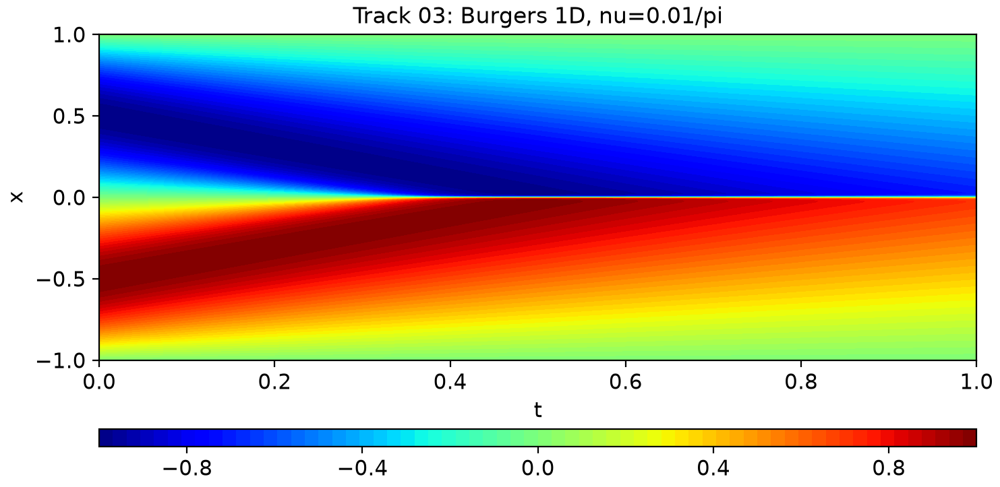
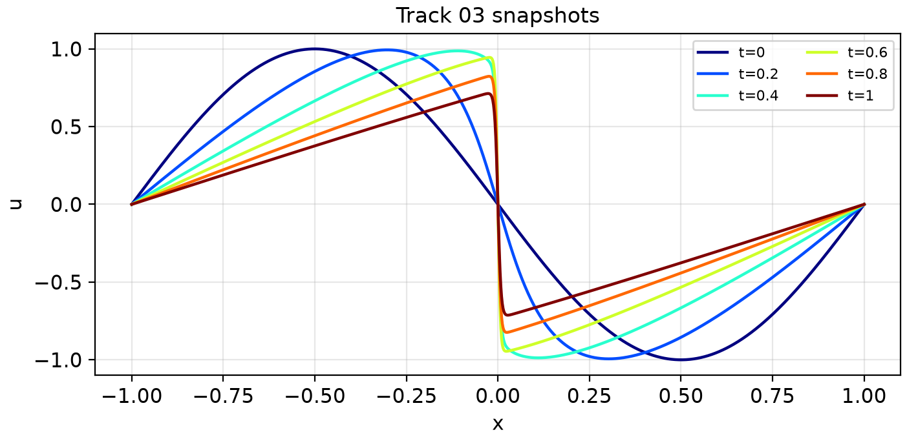
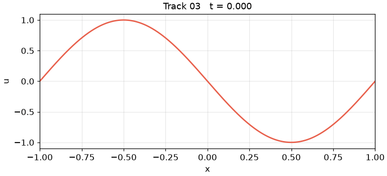
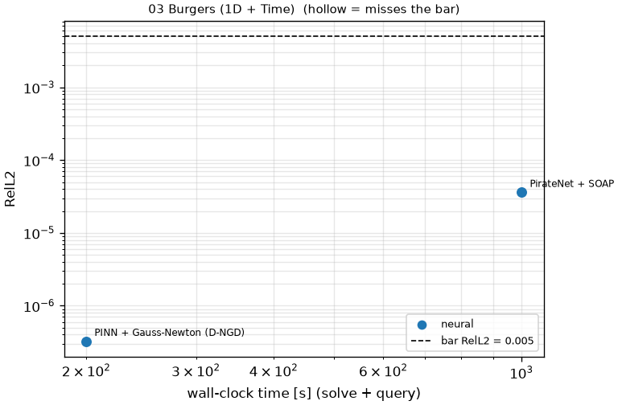
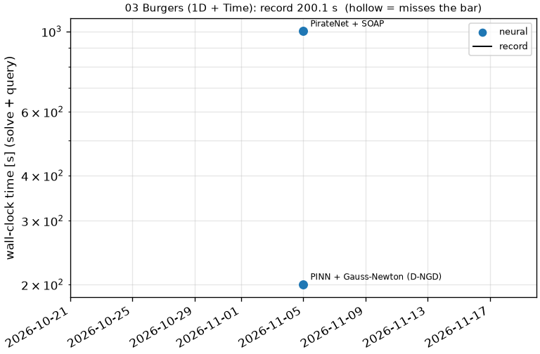

# 03 Burgers (1D + Time): 1D viscous Burgers, nu = 0.01/pi (Raissi)

```text
1D viscous Burgers on (t, x) in [0, 1] x [-1, 1] (Raissi et al. 2019; Shahab et al. 2026, sec. 3.1):

    u_t + u u_x = nu u_xx,          nu = 0.01 / pi
    u(0, x) = -sin(pi x)
    u(t, -1) = u(t, 1) = 0

The two halves of the sine steepen into a stationary shock at x = 0 (width ~ nu) from t ~ 1 / pi on.

Output: u on the tensor grid t = linspace(0, 1, 1001) x x = linspace(-1, 1, 1001); shape (1, 1001, 1001).
```

**Accuracy bar:** RelL2 ≤ 0.005, RelL∞ ≤ 0.01. **Budget:** 1000 s of wall-clock solve time.





## Reference

exact Cole-Hopf solution, trapezoidal rule in z = s / sqrt(4 nu t), 4001 nodes on [-14, 14]

- `check_nodes2001_vs_4001_linf`: 1.998e-15
- `check_z12_vs_z14_linf`: 1.887e-15

## Records

Current record: **200.1 s** (PINN + Gauss-Newton (D-NGD), maintainers, 2026-11-05, NVIDIA H100 80GB HBM3 (JAX)).

| date | author | name | kind | time [s] | RelL2 | RelL∞ | passes | hardware |
|---|---|---|---|---|---|---|---|---|
| 2026-11-05 | maintainers | PirateNet + SOAP | neural | 1001 | 3.61e-05 | 1.46e-04 | yes | NVIDIA H100 80GB HBM3 (JAX) |
| 2026-11-05 | maintainers | PINN + Gauss-Newton (D-NGD) | neural | 200.1 | 3.24e-07 | 3.45e-06 | yes | NVIDIA H100 80GB HBM3 (JAX) |




