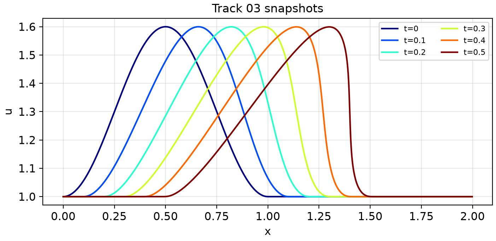
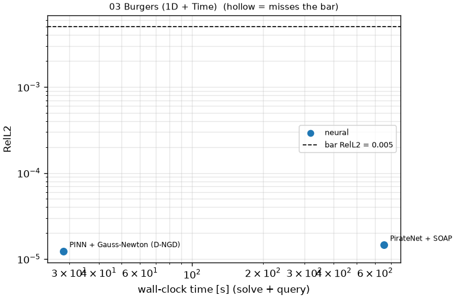
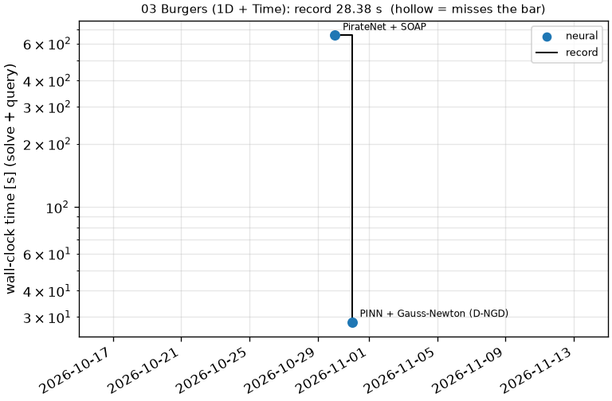

# 03 Burgers (1D + Time): 1D viscous Burgers, nu = 1e-4

```text
1D viscous Burgers on the periodic domain x in [0, 2), t in [0, 0.5]:

    u_t + u u_x = nu u_xx,          nu = 0.0001
    u(0, x) = 1 + (mu / 2) (1 + sin(2 pi x - pi / 2))   for x in [0, 1]
            = 1                                         otherwise,          mu = 0.6

Output: u on the prescribed grid x_j = 2 j / 1024, j = 0..1023, at the 500 snapshot times
t = linspace(0, 0.5, 500); shape (1, 500, 1024).
```

**Accuracy bar:** RelL2 ≤ 0.005, RelL∞ ≤ 0.01. **Budget:** 1000 s of wall-clock solve time.





## Reference

Fourier pseudo-spectral + ETDRK4, N=8192, dt=T/(Nt-1)/16

- `check_N4096_vs_N8192_linf`: 2.123e-08
- `check_N4096_vs_N8192_rel_l2`: 9.921e-11

## Records

Current record: **28.38 s** (PINN + Gauss-Newton (D-NGD), maintainers, 2026-10-31, NVIDIA H100 80GB HBM3 (JAX)).

| date | author | name | kind | time [s] | RelL2 | RelL∞ | passes | hardware |
|---|---|---|---|---|---|---|---|---|
| 2026-10-30 | maintainers | PirateNet + SOAP | neural | 655.6 | 1.46e-05 | 7.56e-05 | yes | NVIDIA H100 80GB HBM3 (JAX) |
| 2026-10-31 | maintainers | PINN + Gauss-Newton (D-NGD) | neural | 28.38 | 1.23e-05 | 1.52e-04 | yes | NVIDIA H100 80GB HBM3 (JAX) |




