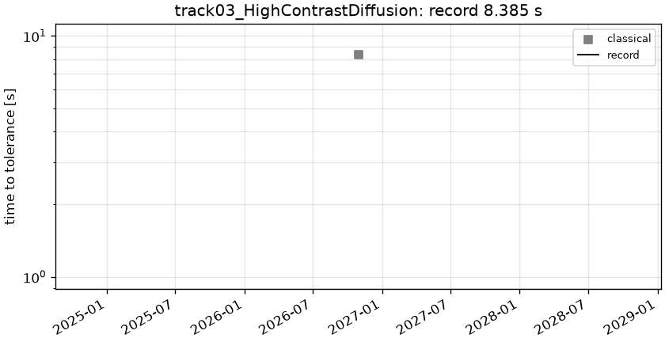

# track03_HighContrastDiffusion: 2D high-contrast diffusion (contrast 1e3)

```text
Steady diffusion with a discontinuous, high-contrast coefficient on the unit square [0, 1]^2:

    -div( a(x, y) grad u ) = f,        u = 0 on the boundary
    a = 1000 inside 9 square inclusions [s_i, e_i] x [s_j, e_j],  a = 1 elsewhere,
        (s, e) in {(2/16, 4/16), (7/16, 9/16), (12/16, 14/16)}
    f = 18

(Flux continuity a grad u . n across the inclusion edges; u and the normal flux are continuous.)

Output: u at the 256 x 256 cell centers x_i = y_i = (i + 1/2) / 256; shape (1, 256, 256).
```

**Accuracy bar:** RelL2 ≤ 0.0001, L∞ ≤ 0.001.


## Reference

cell-centered FV + MG-PCG on 3840^2 and 5376^2 (213, 236 PCG its), Richardson-extrapolated at the observed order p = 1.338

- `check_extrap9_15_vs_ref_rel_l2`: 1.046e-07
- `check_extrap9_15_vs_ref_linf`: 1.168e-06
- `check_N5376_vs_ref_rel_l2`: 2.018e-05
- `check_N5376_vs_ref_linf`: 8.334e-05
- `check_N2304_vs_ref_rel_l2`: 6.269e-05
- `check_N2304_vs_ref_linf`: 2.600e-04

## Records

Current record: **8.385 s** (record #0: classical baseline, maintainers, 2026-10-30, NVIDIA GeForce RTX 2080 Ti).

| date | author | name | kind | time [s] | RelL2 | L∞ | hardware |
|---|---|---|---|---|---|---|---|
| 2026-10-30 | maintainers | record #0: classical baseline | classical | 8.385 | 3.83e-05 | 1.58e-04 | NVIDIA GeForce RTX 2080 Ti |


