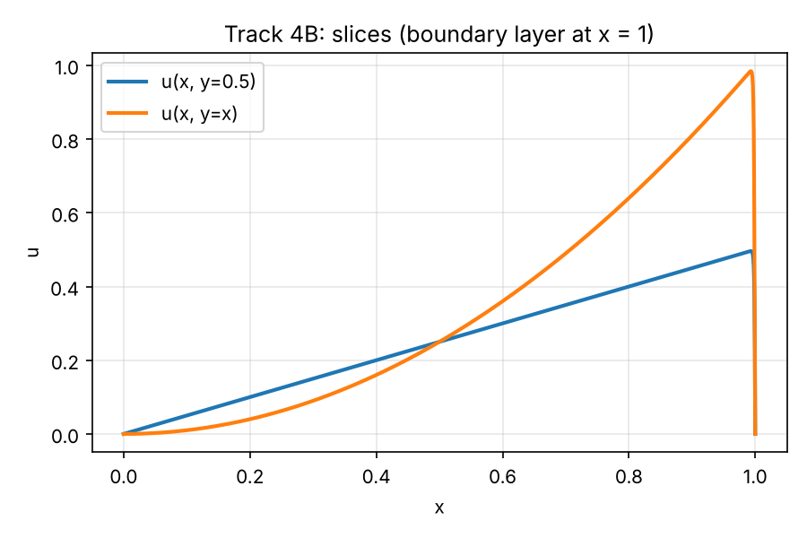
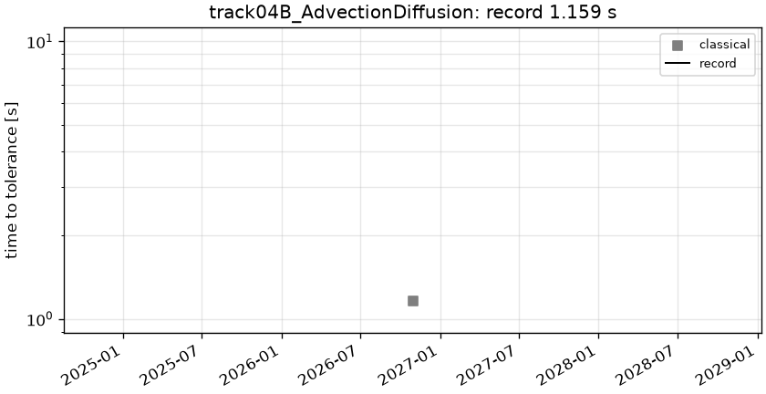

# track04B_AdvectionDiffusion: 2D advection-diffusion, Pe ~ 1e3

```text
Steady advection-diffusion on the unit square [0, 1]^2:

    -eps Lap u + b . grad u = f,      b = (1, 1),   eps = 0.001
    u = 0 on the boundary
    f(x, y) = g(x) + g(y),   g(s) = s - (exp((s - 1)/eps) - exp(-1/eps)) / (1 - exp(-1/eps))

The solution has exponential boundary layers of width ~eps along the outflow walls x = 1 and y = 1.

Output: u on the tensor grid x_i = y_i = (1 - cos(pi i / 256)) / 2, i = 0..256
(Chebyshev-Gauss-Lobatto points, clustered at the walls so the boundary layers are sampled);
shape (1, 257, 257).
```

**Accuracy bar:** RelL2 ≤ 0.0001, L∞ ≤ 0.001.




## Reference

closed form u = g(x) g(y)

- `check_chebyshev_N96_linf`: 3.342e-05

## Records

Current record: **1.159 s** (record #0: classical baseline, maintainers, 2026-10-30, NVIDIA GeForce RTX 2080 Ti).

| date | author | name | kind | time [s] | RelL2 | L∞ | hardware |
|---|---|---|---|---|---|---|---|
| 2026-10-30 | maintainers | record #0: classical baseline | classical | 1.159 | 2.90e-05 | 3.34e-05 | NVIDIA GeForce RTX 2080 Ti |


