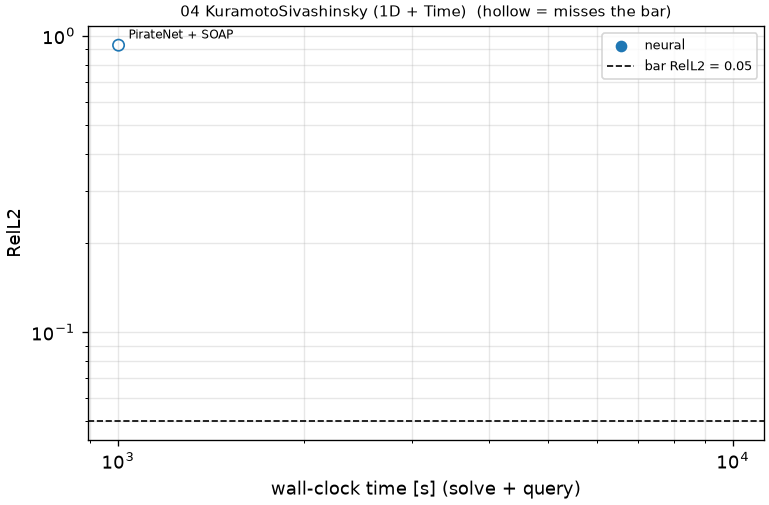

# 04 KuramotoSivashinsky (1D + Time): Kuramoto-Sivashinsky (chaotic)

```text
Kuramoto-Sivashinsky equation on x in [0, 2 pi] (periodic), t in [0, 1], in the chaotic regime:

    u_t + a u u_x + b u_xx + c u_xxxx = 0,      a = 100/16,  b = 100/16^2,  c = 100/16^4

Initial condition: u(0, x) is given as samples on the output x grid (problem.fns["ic"]; problem.fns["u0"] is
its trigonometric interpolant). Small errors grow exponentially; the bar reflects that.

Output: u at t_k = k / 250, k = 1..250, and x_j = 2 pi j / 511, j = 0..511; shape (1, 250, 512).
```

**Accuracy bar:** RelL2 ≤ 0.005, RelL∞ ≤ 0.01. **Budget:** 1000 s of wall-clock solve time.


## Reference

published data (jaxpi)


## Records

Current record: **1000 s** (PirateNet + SOAP, maintainers, 2026-10-30, NVIDIA H100 80GB HBM3 (JAX)).

| date | author | name | kind | time [s] | RelL2 | RelL∞ | passes | hardware |
|---|---|---|---|---|---|---|---|---|
| 2026-10-30 | maintainers | PirateNet + SOAP | neural | 1000 | 9.31e-01 | 1.13e+00 | no | NVIDIA H100 80GB HBM3 (JAX) |


