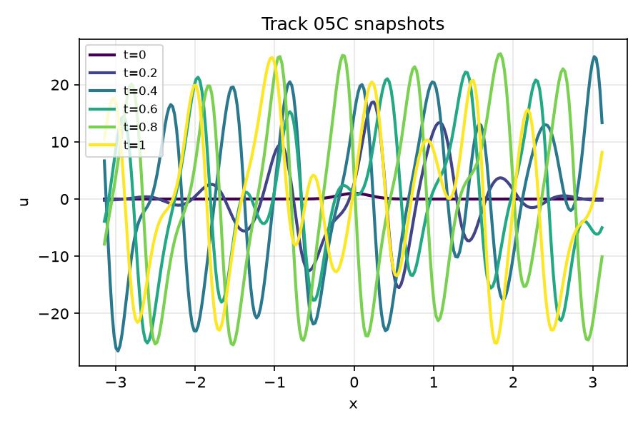
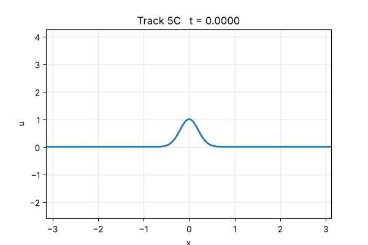
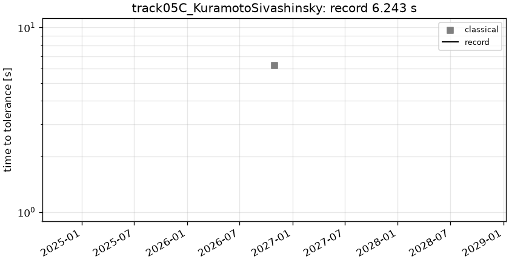

# track05C_KuramotoSivashinsky: 1D Kuramoto-Sivashinsky, nu = 0.01

```text
1D Kuramoto-Sivashinsky on x in [-pi, pi), t in [0, 1], with periodic boundary conditions in x:

    u_t + u u_x + u_xx + nu u_xxxx = 0,        nu = 0.01
    u(0, x) = exp(-x^2 / (2 sigma0^2)),         sigma0 = 0.2

Output: u on the prescribed grid x_j = -pi + 2 pi j / 256, j = 0..255, at the 1000 snapshot
times t = linspace(0, 1, 1000); shape (1, 1000, 256).
```

**Accuracy bar:** RelL2 ≤ 0.0001, L∞ ≤ 0.001.





## Reference

Fourier pseudo-spectral + ETDRK4, N=1024, dt=T/(Nt-1)/64

- `check_dt_x2_linf`: 1.897e-06
- `check_dt_x2_rel_l2`: 4.839e-09

## Records

Current record: **6.243 s** (record #0: classical baseline, maintainers, 2026-10-30, NVIDIA GeForce RTX 2080 Ti).

| date | author | name | kind | time [s] | RelL2 | L∞ | passes | hardware |
|---|---|---|---|---|---|---|---|---|
| 2026-10-30 | maintainers | record #0: classical baseline | classical | 6.243 | 1.04e-07 | 4.06e-05 | yes | NVIDIA GeForce RTX 2080 Ti |



