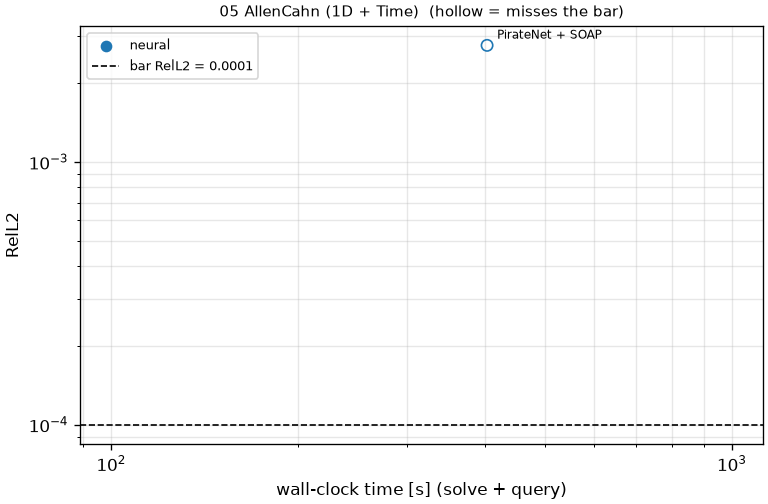

# 05 AllenCahn (1D + Time): Allen-Cahn, eps = 1e-4

```text
Allen-Cahn equation on x in [-1, 1] (periodic), t in [0, 1]:

    u_t - 0.0001 u_xx + 5 u^3 - 5 u = 0
    u(0, x) = x^2 cos(pi x)

Thin interfaces form between the stable states u = -1 and u = +1.

Output: u at t_k = k / 200, k = 1..200, and x_j = -1 + 2 j / 511, j = 0..511;
shape (1, 200, 512).
```

**Accuracy bar:** RelL2 ≤ 0.0001, L∞ ≤ 0.001. **Budget:** 1000 s of wall-clock solve time.


## Reference

published data (jaxpi)


## Records

Current record: **403.1 s** (PirateNet + SOAP, maintainers, 2026-10-30, NVIDIA H100 80GB HBM3 (JAX)).

| date | author | name | kind | time [s] | RelL2 | L∞ | passes | hardware |
|---|---|---|---|---|---|---|---|---|
| 2026-10-30 | maintainers | PirateNet + SOAP | neural | 403.1 | 2.77e-03 | 3.70e-02 | no | NVIDIA H100 80GB HBM3 (JAX) |


