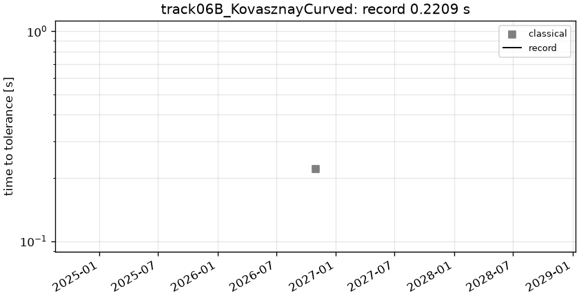

# track06B_KovasznayCurved: Kovasznay flow, Re = 40, curved trapezoid

```text
Kovasznay flow in a curved quadrilateral: the image of the reference square (r, s) in [-1, 1]^2 under the
Gordon-Hall map of its four edges
    bottom (s = -1): (x, y) = (r/2, -1/2)           top (s = +1):   (x, y) = (r, 1 - r^2/2)
    left   (r = -1): (x, y) = (-(3+s)/4, s/2)       right (r = +1): (x, y) = ((3+s)/4, s/2)
i.e.  x = r (3 + s) / 4,   y = (1 + s)/2 (1 - r^2/2) - (1 - s)/4      (problem.fns["map"]).
A trapezoid with corners (-1/2, -1/2), (1/2, -1/2), (1, 1/2), (-1, 1/2) and a parabolic top edge.

Steady incompressible Navier-Stokes, Re = 40:

    (u . grad) u + grad p = (1/Re) Lap u,      div u = 0

Dirichlet velocity on the whole boundary, equal to the Kovasznay (1948) solution
    u = 1 - exp(lam x) cos(2 pi y),   v = (lam / (2 pi)) exp(lam x) sin(2 pi y),
    lam = Re/2 - sqrt(Re^2/4 + 4 pi^2)
(only its boundary values are data; the interior is unknown to the solver). Pressure is NOT scored.

Output: (u, v) at the mapped points map(r_i, s_j), r = s = linspace(-1, 1, 201); shape (2, 201, 201).
```

**Accuracy bar:** RelL2 ≤ 0.0001, L∞ ≤ 0.001.


## Reference

closed form (Kovasznay 1948) at the mapped points

- `check_sem_N24_linf`: 9.707e-11

## Records

Current record: **0.2209 s** (record #0: classical baseline, maintainers, 2026-10-30, NVIDIA GeForce RTX 2080 Ti).

| date | author | name | kind | time [s] | RelL2 | L∞ | hardware |
|---|---|---|---|---|---|---|---|
| 2026-10-30 | maintainers | record #0: classical baseline | classical | 0.2209 | 4.78e-07 | 2.86e-06 | NVIDIA GeForce RTX 2080 Ti |


