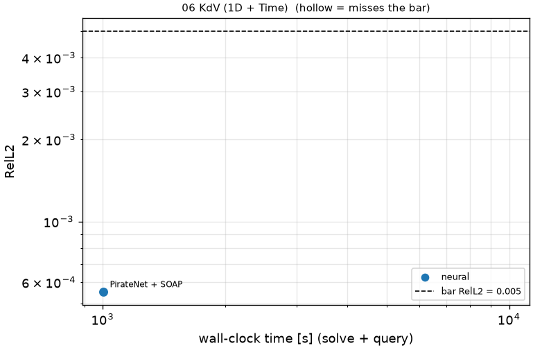
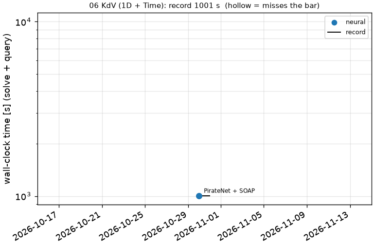

# 06 KdV (1D + Time): Korteweg-de Vries, delta = 0.022

```text
Korteweg-de Vries equation on x in [-1, 1] (periodic), t in [0, 1]:

    u_t + u u_x + 0.022^2 u_xxx = 0
    u(0, x) = cos(pi x)

The cosine steepens and breaks into a train of solitons.

Output: u at t_k = k / 200, k = 1..200, and x_j = -1 + 2 j / 511, j = 0..511;
shape (1, 200, 512).
```

**Accuracy bar:** RelL2 ≤ 0.005, RelL∞ ≤ 0.01. **Budget:** 1000 s of wall-clock solve time.


## Reference

published data (jaxpi)


## Records

Current record: **1001 s** (PirateNet + SOAP, maintainers, 2026-10-30, NVIDIA H100 80GB HBM3 (JAX)).

| date | author | name | kind | time [s] | RelL2 | RelL∞ | passes | hardware |
|---|---|---|---|---|---|---|---|---|
| 2026-10-30 | maintainers | PirateNet + SOAP | neural | 1001 | 5.52e-04 | 1.15e-03 | yes | NVIDIA H100 80GB HBM3 (JAX) |




