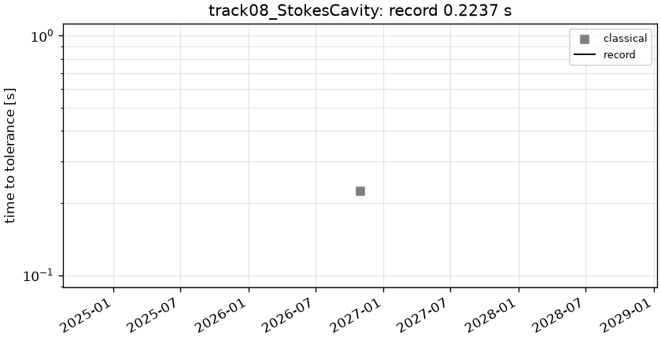

# track08_StokesCavity: Stokes lid-driven cavity

```text
Lid-driven cavity on the square [-1, 1]^2.
Steady incompressible Stokes flow:

    - Lap u + grad p = 0,      div u = 0

Boundary conditions (Dirichlet velocity):
    u = 1, v = 0     on the lid y = 1 (including the corners (+-1, 1))
    u = v = 0        on the other three walls

The velocity is discontinuous at the two top corners. RelL2 is scored over all output points; L-inf
only over points at distance >= 0.05 from the walls (problem.linf_margin). Pressure is NOT scored.

Output: (u, v) on the uniform 129 x 129 grid x, y = linspace(-1, 1, 129);
shape (2, 129, 129).
```

**Accuracy bar:** RelL2 ≤ 0.001, L∞ ≤ 0.001 (L∞ only at points ≥ 0.05 from the walls).


## Reference

single-element Legendre PN-PN-2, N=768, Uzawa CG

- `check_N512_vs_N768_linf_scored`: 3.395e-05
- `check_N512_vs_N768_linf_all`: 1.861e-03
- `check_N512_vs_N768_rel_l2`: 1.141e-04

## Records

Current record: **0.2237 s** (record #0: classical baseline, maintainers, 2026-10-30, NVIDIA GeForce RTX 2080 Ti).

| date | author | name | kind | time [s] | RelL2 | L∞ | passes | hardware |
|---|---|---|---|---|---|---|---|---|
| 2026-10-30 | maintainers | record #0: classical baseline | classical | 0.2237 | 5.02e-04 | 4.01e-04 | yes | NVIDIA GeForce RTX 2080 Ti |



