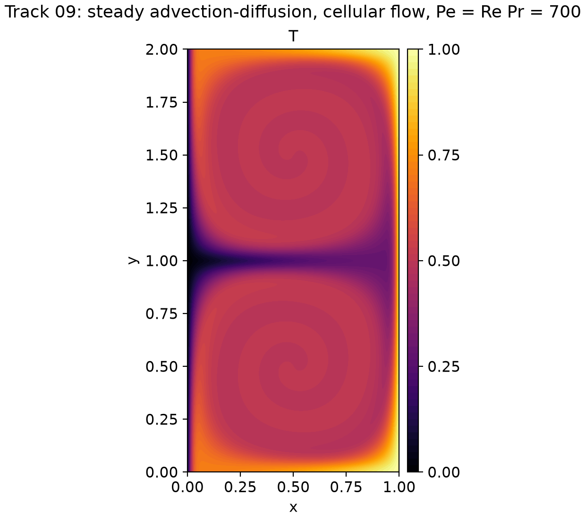
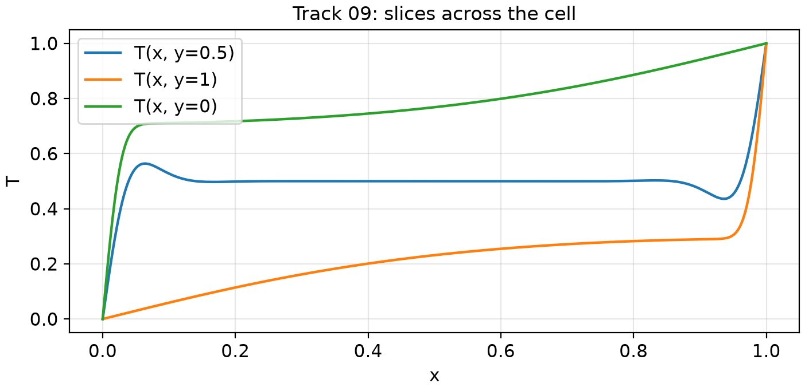
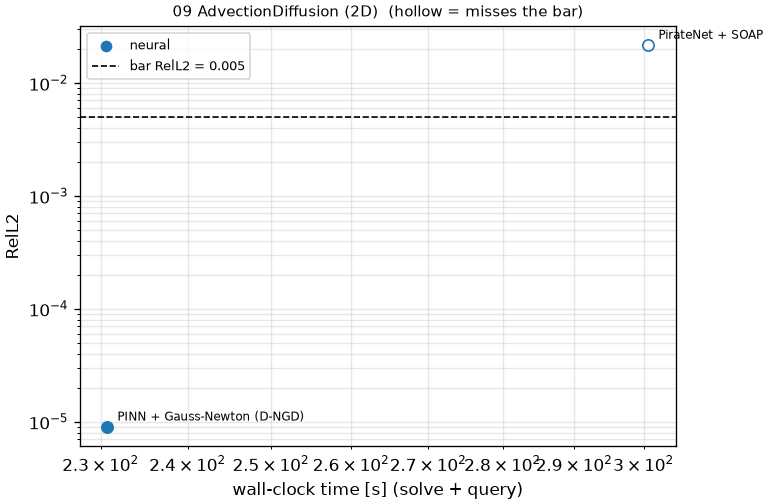
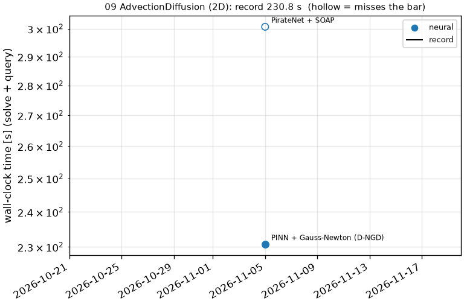

# 09 AdvectionDiffusion (2D): 2D steady advection-diffusion, cellular flow, Pe = 700

```text
Steady advection-diffusion of temperature T(x, y) on [0, 1] x [0, 2] by a prescribed cellular flow:

    (1 / (Re Pr)) (T_xx + T_yy) - u T_x - v T_y = 0,      Re = 100, Pr = 7  (Pe = Re Pr = 700)
    u = -sin(pi x) cos(pi y),   v = cos(pi x) sin(pi y)      (two counter-rotating cells, divergence-free)
    T(0, y) = 0 (cold wall),   T(1, y) = 1 (hot wall),   T_y(x, 0) = T_y(x, 2) = 0 (insulated walls)

The flow carries heat around each cell; at this Pe the isotherms wind into spirals, the walls carry thermal
boundary layers of width ~ Pe^(-1/2), and a thin cold tongue runs along the cell boundary y = 1.

Output: T on the tensor grid x_i = (1 - cos(pi i / 256)) / 2, i = 0..256, and y = the same Chebyshev-Gauss-
Lobatto points on [0, 1] followed by their mirror images 2 - y on (1, 2] (clustered at the walls and at y = 1);
shape (1, 257, 513).
```

**Accuracy bar:** RelL2 ≤ 0.005, RelL∞ ≤ 0.01. **Budget:** 1000 s of wall-clock solve time.





## Reference

Chebyshev collocation on one cell, N = 128, mirrored about y = 1

- `check_N96_linf`: 4.272e-11
- `check_N112_linf`: 5.824e-11
- `check_full_domain_N96x192_linf`: 1.195e-06

## Records

Current record: **230.8 s** (PINN + Gauss-Newton (D-NGD), maintainers, 2026-11-05, NVIDIA H100 80GB HBM3 (JAX)).

| date | author | name | kind | time [s] | RelL2 | RelL∞ | passes | hardware |
|---|---|---|---|---|---|---|---|---|
| 2026-11-05 | maintainers | PirateNet + SOAP | neural | 300.7 | 2.15e-02 | 4.33e-02 | no | NVIDIA H100 80GB HBM3 (JAX) |
| 2026-11-05 | maintainers | PINN + Gauss-Newton (D-NGD) | neural | 230.8 | 8.95e-06 | 2.47e-05 | yes | NVIDIA H100 80GB HBM3 (JAX) |




