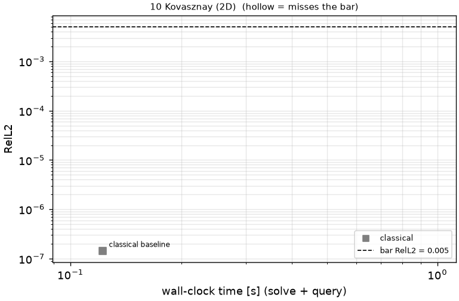
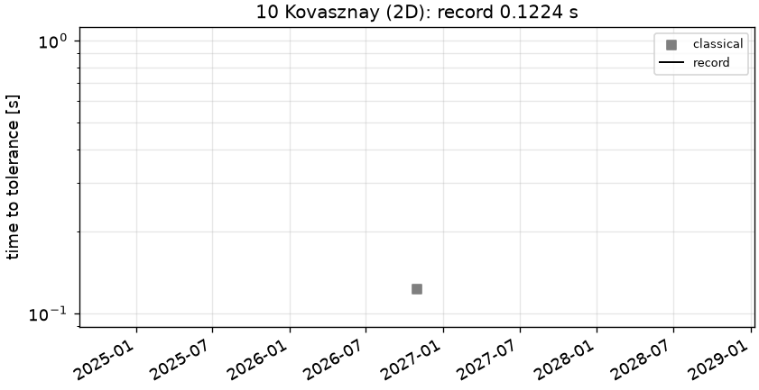

# 10 Kovasznay (2D): Kovasznay flow, Re = 40, rectangle

```text
Kovasznay flow on the rectangle [-0.5, 2.0] x [-0.5, 1.5].

Steady incompressible Navier-Stokes, Re = 40:

    (u . grad) u + grad p = (1/Re) Lap u,      div u = 0

Dirichlet velocity on the whole boundary, equal to the Kovasznay (1948) solution
    u = 1 - exp(lam x) cos(2 pi y),   v = (lam / (2 pi)) exp(lam x) sin(2 pi y),
    lam = Re/2 - sqrt(Re^2/4 + 4 pi^2)
(only its boundary values are data; the interior is unknown to the solver). Pressure is NOT scored.

Output: (u, v) on the tensor grid x = linspace(-0.5, 2.0, 251) x y = linspace(-0.5, 1.5, 201);
shape (2, 251, 201).
```

**Accuracy bar:** RelL2 ≤ 0.005, RelL∞ ≤ 0.01. **Budget:** 1000 s of wall-clock solve time.


## Reference

closed form (Kovasznay 1948)

- `check_sem_N24_linf`: 8.542e-14

## Records

Current record: **0.1224 s** (record #0: classical baseline, maintainers, 2026-10-30, NVIDIA H100 80GB HBM3).

| date | author | name | kind | time [s] | RelL2 | RelL∞ | passes | hardware |
|---|---|---|---|---|---|---|---|---|
| 2026-10-30 | maintainers | record #0: classical baseline | classical | 0.1224 | 1.43e-07 | 1.80e-07 | yes | NVIDIA H100 80GB HBM3 |




