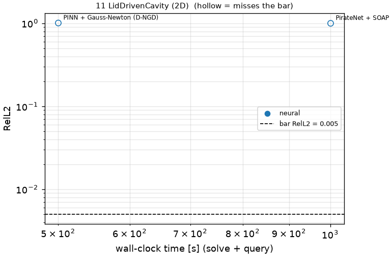
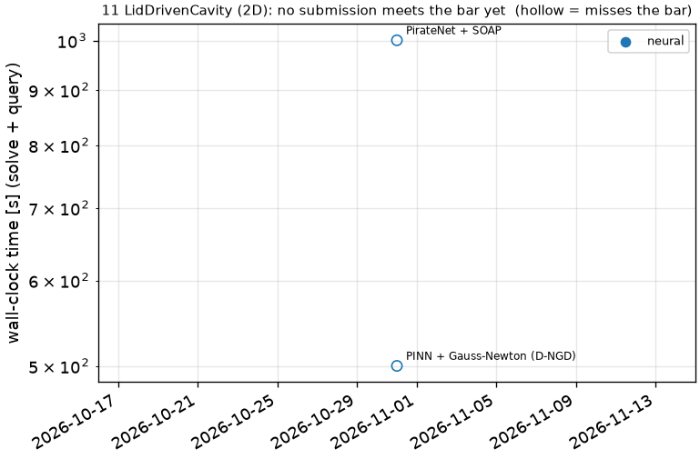

# 11 LidDrivenCavity (2D): Lid-driven cavity, Re = 5000

```text
Steady incompressible Navier-Stokes in the unit square [0, 1]^2, Re = 5000 (nu = 1/Re):

    (u . grad) u + grad p = nu Lap u,      div u = 0
    u = 1 - cosh(50 (x - 0.5)) / cosh(25),  v = 0     on the lid y = 1
    u = v = 0                                        on the other three walls

(The lid profile is 1 except within ~0.05 of the corners, which removes the corner singularities.)
Pressure is not scored. RelL-inf is scored only at points >= 0.05 from the walls.

Output: (u, v) on the 256 x 256 grid x, y = linspace(0, 1, 256); shape (2, 256, 256).
```

**Accuracy bar:** RelL2 ≤ 0.005, RelL∞ ≤ 0.01 (RelL∞ only at points ≥ 0.05 from the walls). **Budget:** 1000 s of wall-clock solve time.


## Reference

published data (jaxpi)


## Records

Current record: **500.1 s** (PINN + Gauss-Newton (D-NGD), maintainers, 2026-10-31, NVIDIA H100 80GB HBM3 (JAX)).

| date | author | name | kind | time [s] | RelL2 | RelL∞ | passes | hardware |
|---|---|---|---|---|---|---|---|---|
| 2026-10-31 | maintainers | PirateNet + SOAP | neural | 1001 | 1.00e+00 | 1.00e+00 | no | NVIDIA H100 80GB HBM3 (JAX) |
| 2026-10-31 | maintainers | PINN + Gauss-Newton (D-NGD) | neural | 500.1 | 1.01e+00 | 1.39e+00 | no | NVIDIA H100 80GB HBM3 (JAX) |




