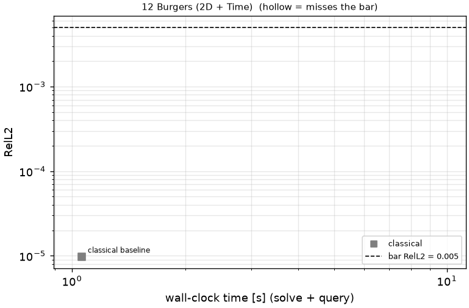
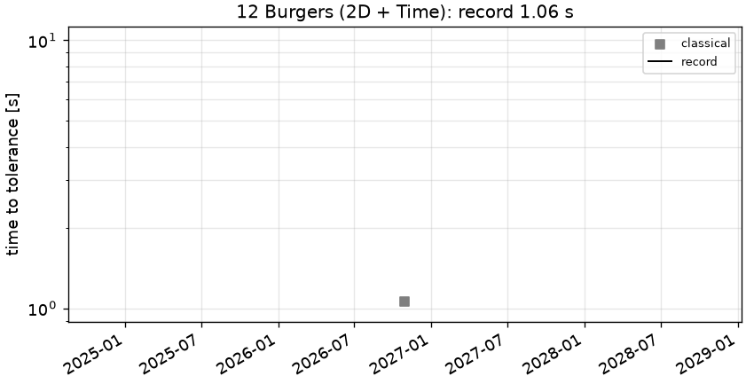

# 12 Burgers (2D + Time): 2D viscous Burgers, nu = 1e-3

```text
2D viscous Burgers (vector form) on the periodic square [-0.25, 0.75)^2, t in [0, 0.5]:

    u_t + (u . grad) u = nu Lap u,      u = (u, v),   nu = 0.001
    u(0, x, y) = v(0, x, y) = mu sin(2 pi x) sin(2 pi y)   for (x, y) in [0, 0.5]^2
               = 0                                          otherwise,           mu = 1.0

A shock forms around t = 0.5.

Output: (u, v) on the prescribed 512 x 512 grid x_i = -0.25 + i / 512, y_j = -0.25 + j / 512, at the
11 snapshot times t = linspace(0, 0.5, 11); shape (2, 11, 512, 512).
```

**Accuracy bar:** RelL2 ≤ 0.005, RelL∞ ≤ 0.01. **Budget:** 1000 s of wall-clock solve time.


## Reference

Fourier pseudo-spectral + ETDRK4, 2048^2, dt=0.00025

- `check_N1024_dt5e-4_vs_ref_linf`: 3.096e-05
- `check_N1024_dt5e-4_vs_ref_rel_l2`: 6.857e-06

## Records

Current record: **1.06 s** (record #0: classical baseline, maintainers, 2026-10-30, NVIDIA H100 80GB HBM3).

| date | author | name | kind | time [s] | RelL2 | RelL∞ | passes | hardware |
|---|---|---|---|---|---|---|---|---|
| 2026-10-30 | maintainers | record #0: classical baseline | classical | 1.06 | 9.70e-06 | 2.63e-04 | yes | NVIDIA H100 80GB HBM3 |




