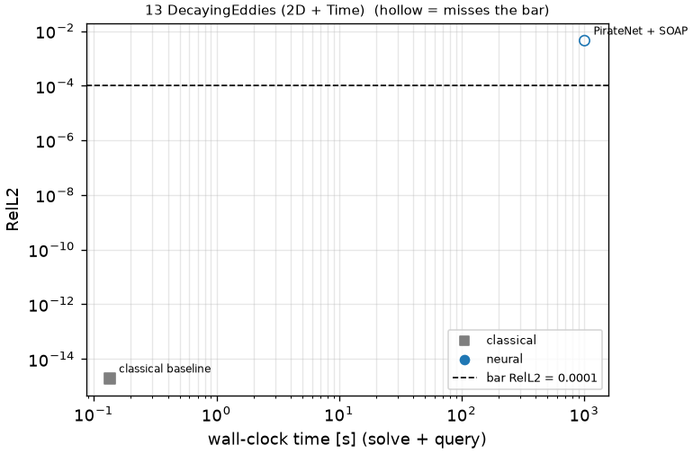
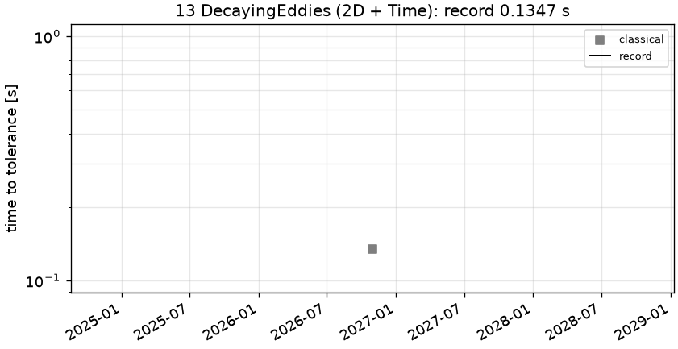

# 13 DecayingEddies (2D + Time): Decaying eddies (Walsh), nu = 0.05

```text
Unsteady incompressible Navier-Stokes on the periodic square [0, 2 pi)^2, t in [0, 5], nu = 0.05:

    u_t + (u . grad) u + grad p = nu Lap u,      div u = 0
    u(0, x, y) = sin(5 y) + cos(3 x) cos(4 y)
    v(0, x, y) = cos(5 x) + 0.75 sin(3 x) sin(4 y)

(Walsh's decaying eddies.) Pressure is NOT scored.

Output: (u, v) on the 128 x 128 grid x_i = y_i = 2 pi i / 128 at the 11 times t = linspace(0, 5, 11);
shape (2, 11, 128, 128).
```

**Accuracy bar:** RelL2 ≤ 0.0001, L∞ ≤ 0.001. **Budget:** 1000 s of wall-clock solve time.


## Reference

closed form (Walsh 1992)

- `check_fourier_N64_linf`: 5.385e-15

## Records

Current record: **0.1347 s** (record #0: classical baseline, maintainers, 2026-10-30, NVIDIA GeForce RTX 2080 Ti).

| date | author | name | kind | time [s] | RelL2 | L∞ | passes | hardware |
|---|---|---|---|---|---|---|---|---|
| 2026-10-30 | maintainers | PirateNet + SOAP | neural | 1000 | 4.49e-03 | 6.42e-03 | no | NVIDIA H100 80GB HBM3 (JAX) |
| 2026-10-30 | maintainers | record #0: classical baseline | classical | 0.1347 | 1.92e-15 | 7.72e-15 | yes | NVIDIA GeForce RTX 2080 Ti |




