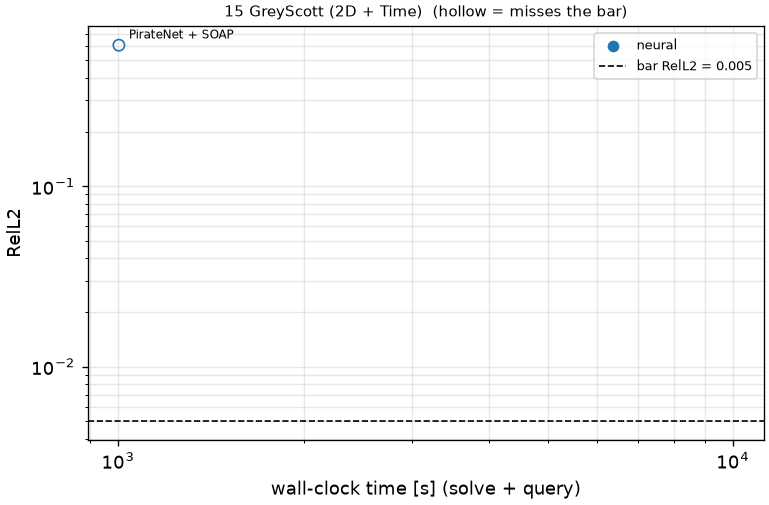
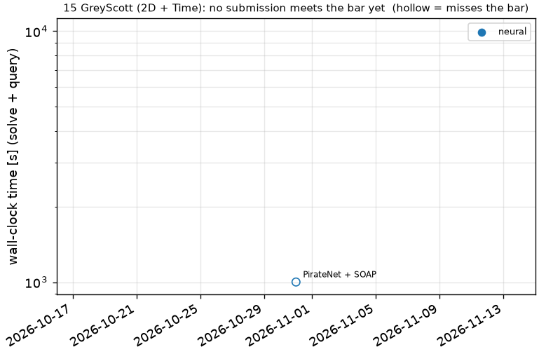

# 15 GreyScott (2D + Time): Grey-Scott reaction-diffusion

```text
Grey-Scott reaction-diffusion system on (x, y) in [-1, 1]^2 (periodic), t in [0, 2]:

    u_t = eps1 Lap u + b1 (1 - u) - c1 u v^2,      eps1 = 0.2, b1 = 40, c1 = 1000
    v_t = eps2 Lap v - b2 v      + c2 u v^2,      eps2 = 0.1, b2 = 100, c2 = 1000

Initial condition: (u, v)(0, x, y) given as samples on the output grid (problem.fns["ic"]; problem.fns["u0"],
["v0"] are their trigonometric interpolants).

Output: (u, v) at t_k = 0.02 k, k = 1..100, on the 200 x 200 grid x_i, y_j = -1 + 2 i / 199;
shape (2, 100, 200, 200).
```

**Accuracy bar:** RelL2 ≤ 0.005, RelL∞ ≤ 0.01. **Budget:** 1000 s of wall-clock solve time.


## Reference

published data (jaxpi)


## Records

Current record: **1002 s** (PirateNet + SOAP, maintainers, 2026-10-31, NVIDIA H100 80GB HBM3 (JAX)).

| date | author | name | kind | time [s] | RelL2 | RelL∞ | passes | hardware |
|---|---|---|---|---|---|---|---|---|
| 2026-10-31 | maintainers | PirateNet + SOAP | neural | 1002 | 6.04e-01 | 7.35e-01 | no | NVIDIA H100 80GB HBM3 (JAX) |




