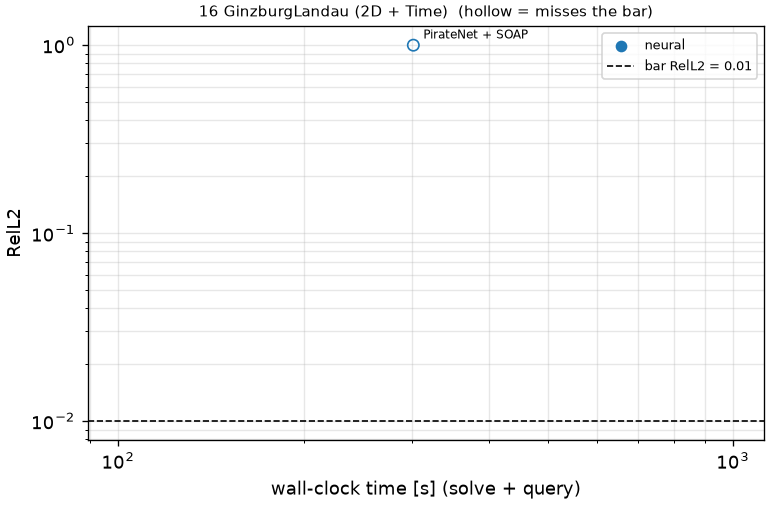

# 16 GinzburgLandau (2D + Time): Ginzburg-Landau

```text
Complex Ginzburg-Landau equation, written for A = u + i v, on (x, y) in [-1, 1]^2 (periodic), t in [0, 1]:

    u_t = eps Lap u + k ( u - (u^2 + v^2) u + 1.5 (u^2 + v^2) v )
    v_t = eps Lap v + k ( v - (u^2 + v^2) v - 1.5 (u^2 + v^2) u ),        eps = 0.004, k = 10

Initial condition: (u, v)(0, x, y) given as samples on the output grid (problem.fns["ic"]; problem.fns["u0"],
["v0"] are their trigonometric interpolants).

Output: (u, v) at t_k = 0.01 k, k = 1..100, on the 200 x 200 grid x_i, y_j = -1 + 2 i / 199;
shape (2, 100, 200, 200).
```

**Accuracy bar:** RelL2 ≤ 0.01, RelL∞ ≤ 0.05. **Budget:** 1000 s of wall-clock solve time.


## Reference

published data (jaxpi)


## Records

Current record: **301.7 s** (PirateNet + SOAP, maintainers, 2026-10-31, NVIDIA H100 80GB HBM3 (JAX)).

| date | author | name | kind | time [s] | RelL2 | RelL∞ | passes | hardware |
|---|---|---|---|---|---|---|---|---|
| 2026-10-31 | maintainers | PirateNet + SOAP | neural | 301.7 | 9.99e-01 | 1.02e+00 | no | NVIDIA H100 80GB HBM3 (JAX) |


