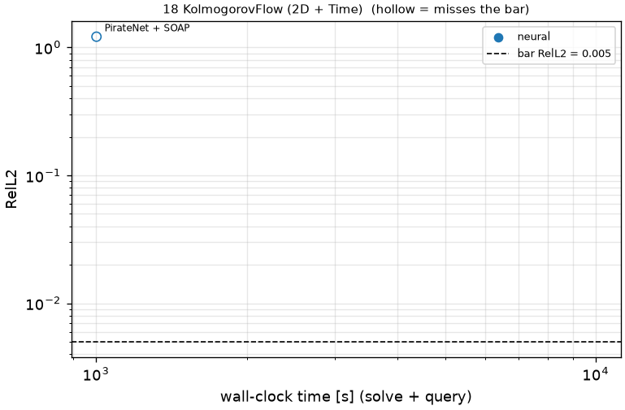
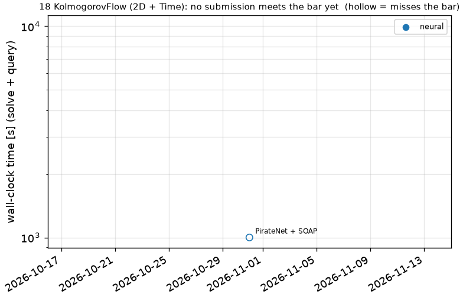

# 18 KolmogorovFlow (2D + Time): Kolmogorov flow, Re = 1e4

```text
Forced 2D incompressible Navier-Stokes (Kolmogorov flow), Re = 1e4, on [0, 1)^2 (periodic), t in [0, 1.96]:

    u_t + (u . grad) u + p_x = nu Lap u + 2 sin(4 pi y)
    v_t + (u . grad) v + p_y = nu Lap v,              u_x + v_y = 0,      nu = 1e-4

Initial condition: (u, v)(0, x, y) given as samples on the output grid (problem.fns["ic"]; problem.fns["u0"],
["v0"] are their trigonometric interpolants). The flow is turbulent; the bar reflects that.

Output: (u, v) at t_k = 0.04 k, k = 1..49, on the 256 x 256 grid of cell centers x_i, y_j = (i + 1/2) / 256;
shape (2, 49, 256, 256). Pressure is not scored.
```

**Accuracy bar:** RelL2 ≤ 0.005, RelL∞ ≤ 0.01. **Budget:** 1000 s of wall-clock solve time.


## Reference

published data (jaxpi)


## Records

Current record: **1001 s** (PirateNet + SOAP, maintainers, 2026-10-31, NVIDIA H100 80GB HBM3 (JAX)).

| date | author | name | kind | time [s] | RelL2 | RelL∞ | passes | hardware |
|---|---|---|---|---|---|---|---|---|
| 2026-10-31 | maintainers | PirateNet + SOAP | neural | 1001 | 1.21e+00 | 1.41e+00 | no | NVIDIA H100 80GB HBM3 (JAX) |




