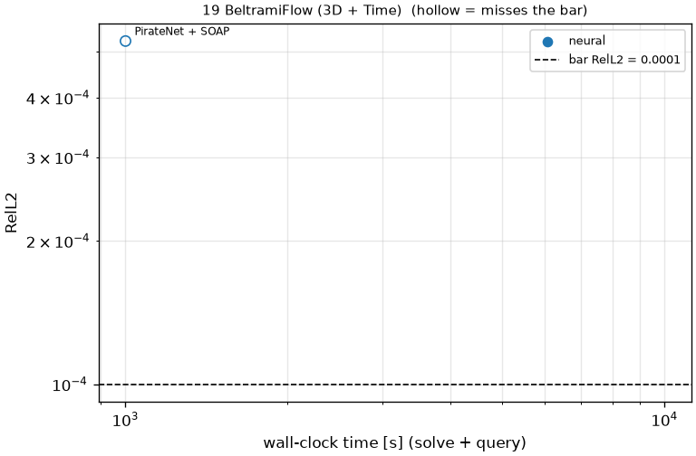

# 19 BeltramiFlow (3D + Time): 3D Beltrami flow, Re = 1

```text
3D unsteady incompressible Navier-Stokes on (x, y, z) in [-1, 1]^3, t in [0, 1], nu = 1 (Re = 1):

    u_t + (u . grad) u + grad p = nu Lap u,      div u = 0,        u = (u, v, w)

Initial velocity at t = 0 and Dirichlet velocity on all six faces for t in [0, 1] are those of the
Ethier-Steinman (1994) Beltrami flow with a = d = 1 (problem.fns["u0"], ["v0"], ["w0"] and
problem.fns["u_bc"], ["v_bc"], ["w_bc"], functions of (t, x, y, z)); the interior is unknown to the solver.
Pressure is not scored.

Output: (u, v, w) at t = 0.25, 0.5, 0.75, 1 on the 33^3 grid x, y, z = linspace(-1, 1, 33);
shape (3, 4, 33, 33, 33).
```

**Accuracy bar:** RelL2 ≤ 0.0001, L∞ ≤ 0.001. **Budget:** 1000 s of wall-clock solve time.


## Reference

closed form (Ethier & Steinman 1994)


## Records

Current record: **1000 s** (PirateNet + SOAP, maintainers, 2026-10-30, NVIDIA H100 80GB HBM3 (JAX)).

| date | author | name | kind | time [s] | RelL2 | L∞ | passes | hardware |
|---|---|---|---|---|---|---|---|---|
| 2026-10-30 | maintainers | PirateNet + SOAP | neural | 1000 | 5.26e-04 | 1.88e-03 | no | NVIDIA H100 80GB HBM3 (JAX) |


