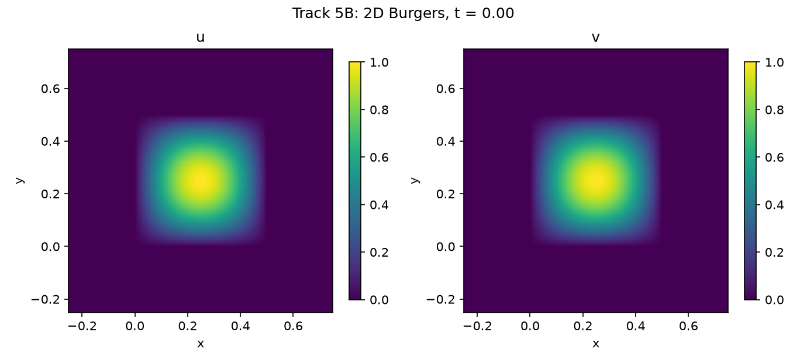
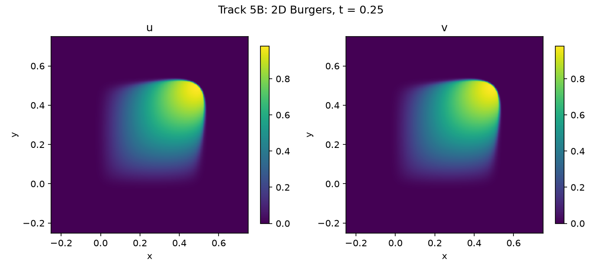
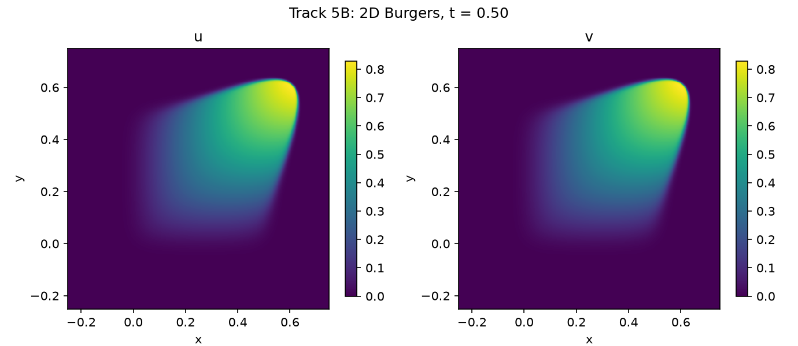
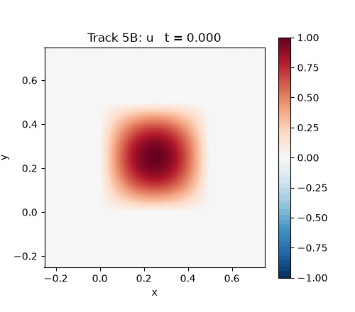
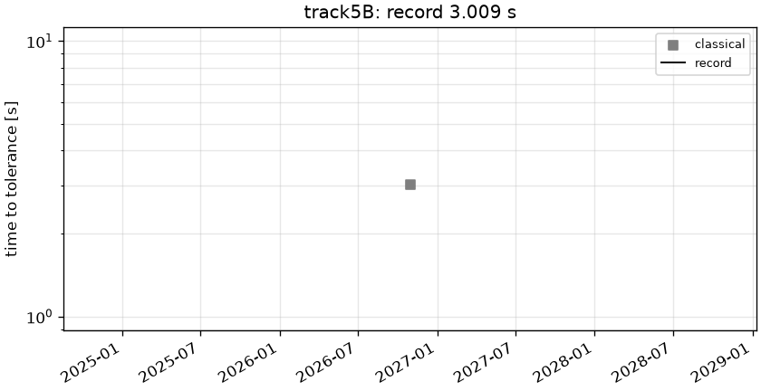

# track5B: 2D viscous Burgers, nu = 1e-3

```text
2D viscous Burgers (vector form) on the periodic square [-0.25, 0.75)^2, t in [0, 0.5]:

    u_t + (u . grad) u = nu Lap u,      u = (u, v),   nu = 0.001
    u(0, x, y) = v(0, x, y) = mu sin(2 pi x) sin(2 pi y)   for (x, y) in [0, 0.5]^2
               = 0                                          otherwise,           mu = 1.0

A shock forms around t = 0.5.

Output: (u, v) on the prescribed 512 x 512 grid x_i = -0.25 + i / 512, y_j = -0.25 + j / 512, at the
11 snapshot times t = linspace(0, 0.5, 11); shape (2, 11, 512, 512).
```






## Reference

Fourier pseudo-spectral + ETDRK4, 1024^2, dt=0.0005

- `check_N512_dt1e-3_vs_ref_linf`: 1.555e-03
- `check_N512_dt1e-3_vs_ref_rel_l2`: 1.184e-04

## Records

Current record: **3.009 s** (record #0: classical baseline, maintainers, 2026-10-30, NVIDIA GeForce RTX 2080 Ti).

| date | author | name | kind | time [s] | RelL2 | L∞ | hardware |
|---|---|---|---|---|---|---|---|
| 2026-10-30 | maintainers | record #0: classical baseline | classical | 3.009 | 1.18e-04 | 1.55e-03 | NVIDIA GeForce RTX 2080 Ti |


